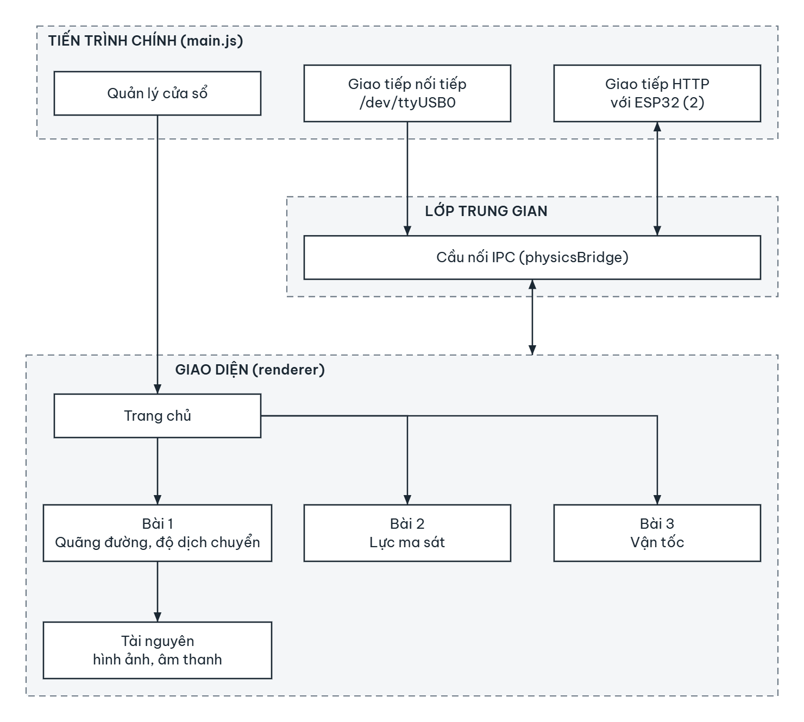
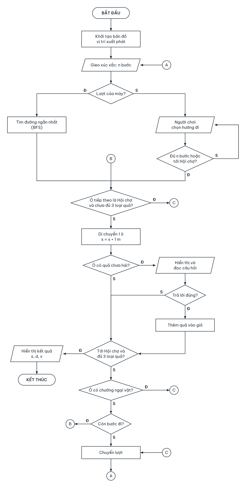
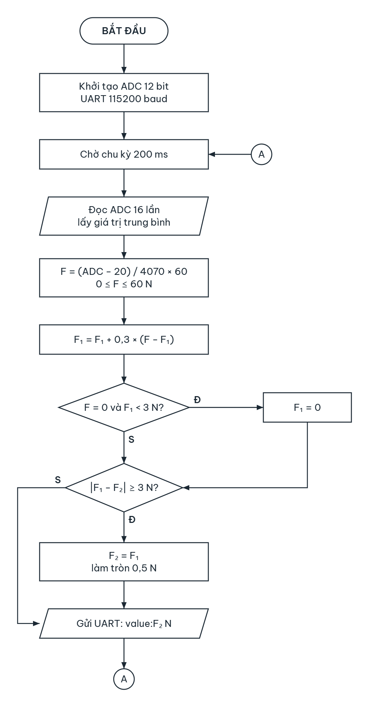
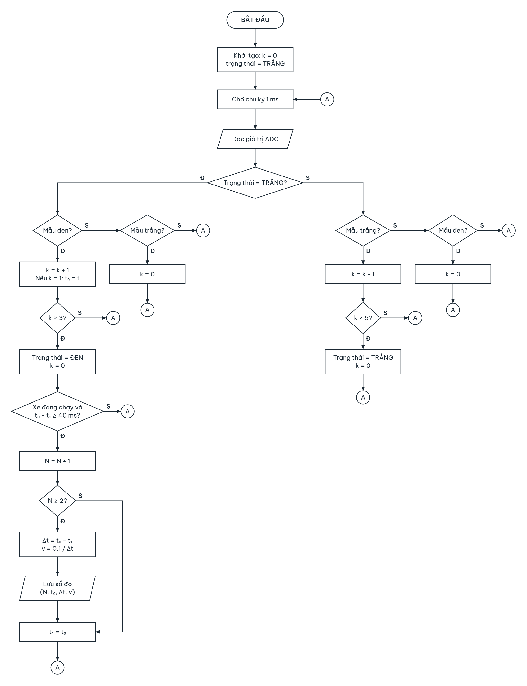
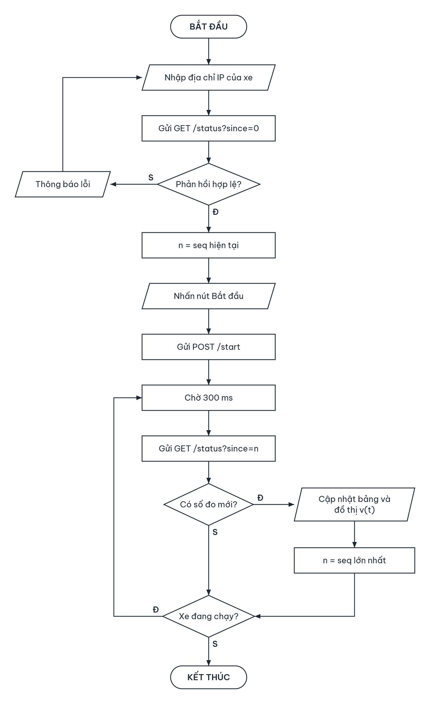
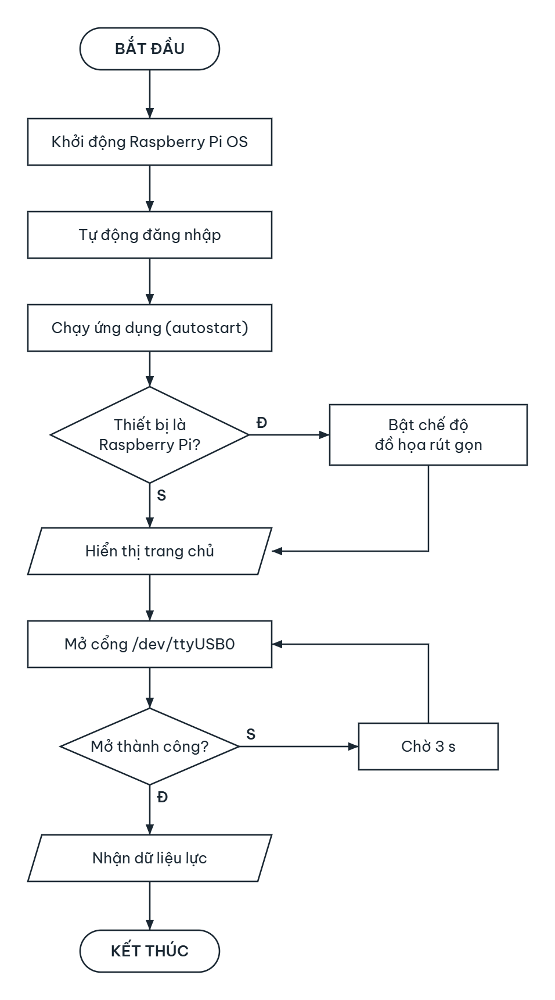

# Tài liệu hệ thống Phòng thí nghiệm Vật lý tương tác

Tài liệu mô tả toàn bộ thiết bị: phần cứng, phần mềm, giao thức truyền dữ liệu, giải thuật, cách cài đặt, vận hành và bảo trì. Nội dung được lập theo mã nguồn và cấu hình thiết bị ngày 24/11/2026.

## Mục lục

1. [Tổng quan](#1-tổng-quan)
2. [Sơ đồ khối tổng quát](#2-sơ-đồ-khối-tổng-quát)
3. [Phần cứng](#3-phần-cứng)
4. [Truyền thông giữa các khối](#4-truyền-thông-giữa-các-khối)
5. [Phần mềm trên Raspberry Pi](#5-phần-mềm-trên-raspberry-pi)
6. [Các bài học](#6-các-bài-học)
7. [Khởi động và vận hành](#7-khởi-động-và-vận-hành)
8. [Cài đặt và triển khai](#8-cài-đặt-và-triển-khai)
9. [Bảo trì và mở rộng](#9-bảo-trì-và-mở-rộng)
10. [Hiệu năng trên Raspberry Pi 3](#10-hiệu-năng-trên-raspberry-pi-3)
11. [Xử lý sự cố](#11-xử-lý-sự-cố)
12. [Tình trạng hiện tại](#12-tình-trạng-hiện-tại)
13. [Phụ lục](#13-phụ-lục)

---

## 1. Tổng quan

Thiết bị hỗ trợ dạy Vật lý lớp 10 bằng màn hình cảm ứng. Học sinh chơi trò chơi, đo lực bằng cảm biến và đo vận tốc bằng xe robot; số liệu đo hiển thị trực tiếp trên màn hình.

| Bài | Tên trên màn hình | Nội dung Vật lý | Nguồn dữ liệu |
|---|---|---|---|
| 1 | Khu vườn trên mây | Quãng đường, độ dịch chuyển, tốc độ và vận tốc trung bình | Trò chơi trên màn hình |
| 2 | Lực ma sát | Lực ma sát nghỉ, điều kiện để vật chuyển động | Cảm biến lực FSR402 qua USB, hoặc thanh trượt |
| 3 | Vận tốc | Vận tốc tại từng thời điểm, đồ thị v(t) | Xe robot ESP32 qua Wi-Fi, hoặc mô phỏng |
| 4 | Bài học mới | Chỗ trống cho mô-đun sau | – |

Thành phần chính:

- **Raspberry Pi 3B** chạy ứng dụng Electron, nối màn hình cảm ứng 7 inch và loa.
- **ESP32 (1)** đọc cảm biến lực FSR402, gửi lực cho Pi qua cáp USB.
- **ESP32 (2)** trên xe robot: đọc cảm biến dò line, điều khiển động cơ qua L298N, đo vận tốc và gửi cho Pi qua Wi-Fi.

---

## 2. Sơ đồ khối tổng quát


*Hình 1. Sơ đồ khối tổng quát của hệ thống*

| Khối | Thành phần | Chức năng |
|---|---|---|
| Khối nguồn | Adapter 5 V – 2,5 A | Cấp nguồn cho Raspberry Pi và thiết bị USB |
| Khối xử lý trung tâm | Raspberry Pi 3B, RAM 1 GB | Chạy ứng dụng, xử lý dữ liệu đo, điều khiển xe qua HTTP |
| Khối hiển thị | Màn hình cảm ứng 7 inch (HDMI + USB) | Hiển thị bài học, nhận thao tác chạm |
| Khối âm thanh | Loa (jack 3,5 mm) | Phát bài hát và giọng đọc câu hỏi |
| Khối đo lực | FSR402, ESP32 (1) | Đo lực ấn 0–60 N, gửi qua UART |
| Khối xe đo vận tốc | Cảm biến dò line, ESP32 (2), L298N, 2 động cơ DC, pin | Đo thời gian qua các vạch đen cách nhau 10 cm, tính vận tốc |
| Khối truyền thông | Router Wi-Fi | Mạng cục bộ giữa Pi và xe; không cần Internet khi học |

---

## 3. Phần cứng

### 3.1. Raspberry Pi

| Mục | Giá trị trên thiết bị hiện tại |
|---|---|
| Model | Raspberry Pi 3 Model B Rev 1.2 |
| Hệ điều hành | Raspberry Pi OS 13 (trixie), 32-bit `armv7l` |
| Tài khoản | `pap`, tự đăng nhập vào desktop |
| Thư mục ứng dụng | `/home/pap/Desktop/teach-physics` |
| Thẻ nhớ | 16 GB |
| Đồ họa | Chromium không dùng được GPU của Pi 3 (VC4 chỉ hỗ trợ OpenGL ES 2.0), mọi hình ảnh do CPU vẽ |

### 3.2. Khối đo lực

Mã nguồn: [touch-esp32/fsr402_uart/fsr402_uart.ino](../touch-esp32/fsr402_uart/fsr402_uart.ino)

Đấu nối:

- `3V3 → FSR402 → GPIO34`
- Điện trở 10 kΩ từ `GPIO34` xuống `GND`
- Cáp USB từ ESP32 vào Raspberry Pi: vừa cấp nguồn vừa truyền dữ liệu. Trên Pi cổng thường là `/dev/ttyUSB0`.

Thông số xử lý:

| Tham số | Giá trị | Ý nghĩa |
|---|---|---|
| `SEND_INTERVAL_MS` | 200 ms | Chu kỳ gửi (5 lần/giây) |
| `ADC_SAMPLES` | 16 | Số lần đọc ADC để lấy trung bình |
| `ADC_ZERO`, `ADC_SATURATION` | 20, 4090 | Dải ADC quy đổi tuyến tính thành 0–60 N |
| `FILTER_ALPHA` | 0,30 | Hệ số bộ lọc EMA |
| `UPDATE_DEADBAND_N` | 3 N | Chỉ cập nhật giá trị gửi khi lệch từ 3 N trở lên |
| `OUTPUT_STEP_N` | 0,5 N | Bước làm tròn |

FSR402 không phải cảm biến lực chính xác; quy đổi tuyến tính nhằm cho cảm giác điều khiển đều trên toàn dải. Có thể chỉnh `ADC_ZERO` và `ADC_SATURATION` theo từng cảm biến.

### 3.3. Xe đo vận tốc

Mã nguồn: [arduino/esp32_line_robot/esp32_line_robot.ino](../arduino/esp32_line_robot/esp32_line_robot.ino), hướng dẫn chi tiết tại [arduino/esp32_line_robot/README.md](../arduino/esp32_line_robot/README.md).

| L298N / cảm biến | ESP32 |
|---|---|
| ENA (PWM động cơ trái) | GPIO23 |
| IN1, IN2 | GPIO22, GPIO21 |
| IN3, IN4 | GPIO19, GPIO18 |
| ENB (PWM động cơ phải) | GPIO5 |
| A0 cảm biến dò line | GPIO34 (ADC1) |
| GND | Nối chung ESP32, L298N, cảm biến |

Lưu ý:

- Không dùng GPIO4 cho tín hiệu analog: GPIO4 thuộc ADC2, không đọc được ổn định khi Wi-Fi bật.
- Tháo jumper ENA/ENB trên L298N để ESP32 điều khiển PWM.
- Động cơ dùng nguồn pin riêng, không lấy từ chân 3V3 của ESP32.
- Đường đo gồm các vạch đen ngang cách nhau **10 cm**, rộng 1,5–2 cm. Xe chạy thẳng dọc dãy vạch; một cảm biến không tự lái theo đường cong.
- Xe không có encoder, vận tốc thực phụ thuộc pin và mặt sàn. Đó là lý do vận tốc được đo bằng vạch.

Thông tin Wi-Fi và ngưỡng cảm biến đặt trong `robot_config.h` (cạnh file `.ino`, không đưa lên Git):

```c
#pragma once
#define WIFI_SSID "ten-wifi"
#define WIFI_PASSWORD "mat-khau"
#define LINE_SENSOR_PIN 34
#define LINE_SENSOR_ANALOG 1
#define LINE_SENSOR_THRESHOLD 1800
#define LINE_BLACK_BELOW_THRESHOLD 1
#define LINE_DIGITAL_BLACK_LOW 1
```

---

## 4. Truyền thông giữa các khối

| Kết nối | Giao thức | Dữ liệu | Chu kỳ |
|---|---|---|---|
| ESP32 (1) → Pi | UART qua USB, 115200 baud, mỗi dòng một giá trị | `value:32.50N` | 200 ms |
| Pi → ESP32 (2) | HTTP, cổng 80 | `POST /start`, `/stop`, `/reset` | Theo thao tác |
| ESP32 (2) → Pi | HTTP, cổng 80 | `GET /status?since=n`, phản hồi JSON | Pi hỏi mỗi 300 ms |
| Cảm biến → ESP32 (2) | Analog GPIO34, ADC 12 bit | Mức đen/trắng | 1 ms |
| ESP32 (2) → L298N | PWM 2 kHz, 8 bit | Độ rộng xung 160–255 | 20 ms |

### 4.1. Cổng nối tiếp

Ứng dụng chấp nhận ba dạng dòng dữ liệu:

```text
value:32.50N                     ← định dạng của ESP32 (1)
{"type":"force","value":32.5}    ← JSON đầy đủ
32.5                             ← chỉ một số, được hiểu là lực (N)
```

Dòng không đúng định dạng được báo trên giao diện, không làm dừng ứng dụng. Nếu cổng chưa có thiết bị, ứng dụng thử mở lại sau mỗi 3 s.

### 4.2. HTTP của xe

| Lệnh | Chức năng |
|---|---|
| `POST /start` | Xóa số vạch, đặt mốc thời gian, cho động cơ chạy |
| `POST /stop` | Dừng động cơ, giữ số liệu |
| `POST /reset` | Dừng động cơ, xóa số vạch |
| `GET /status?since=n` | Trạng thái xe và các số đo có số thứ tự lớn hơn `n` |
| `GET /` | Trang điều khiển mở được bằng điện thoại hoặc laptop cùng Wi-Fi |

Ví dụ phản hồi `/status`:

```json
{"type":"speed","boot_id":184467,"seq":3,"value":1.237,"unit":"km/h","speed_mps":0.3436,
 "distance_m":0.40,"line_count":4,"line_spacing_m":0.100,"elapsed_s":1.62,"pwm":205,
 "running":true,"stop_reason":"","sensor_raw":3120,"on_line":false,
 "events":[
  {"seq":2,"line":3,"t_s":1.181,"interval_s":0.3740,"speed_mps":0.2674,"speed_kmh":0.963},
  {"seq":3,"line":4,"t_s":1.472,"interval_s":0.2910,"speed_mps":0.3436,"speed_kmh":1.237}]}
```

- Mỗi phần tử `events` là một vạch: thời điểm `t_s`, khoảng thời gian `interval_s` tới vạch trước, vận tốc `speed_mps = 0,10 / interval_s`.
- Pi gửi kèm `since` là số thứ tự cuối đã nhận, nên không bỏ sót số đo nào. ESP32 giữ 64 số đo gần nhất.
- `boot_id` đổi khi ESP32 khởi động lại; Pi dựa vào đó để đọc lại từ đầu.
- Vận tốc được tính trên ESP32 tại thời điểm qua vạch, độ trễ mạng không ảnh hưởng kết quả.

Vì lý do an toàn, ứng dụng chỉ kết nối tới địa chỉ IP nội bộ (`10.x`, `172.16–31.x`, `192.168.x`, `169.254.x`) hoặc tên `.local`, và chờ tối đa 4 s cho mỗi yêu cầu.

---

## 5. Phần mềm trên Raspberry Pi

### 5.1. Cấu trúc mã nguồn

```text
teach-physics/
├── src/
│   ├── main.js                  Tiến trình chính: cửa sổ, cổng nối tiếp, HTTP tới xe
│   ├── preload.js               Cầu nối IPC, bật chế độ nhẹ trên Pi
│   └── renderer/
│       ├── index.html
│       ├── app.js               Trang chủ, hướng dẫn, bài hát, hộp thoại cảm biến
│       ├── styles.css           Giao diện, gồm khối CSS chế độ nhẹ (physics-lite)
│       ├── lessons/
│       │   ├── questions.js     Bộ 10 câu hỏi Bài 1 (dùng chung cho tạo giọng đọc)
│       │   ├── displacement.js  Bài 1: Khu vườn trên mây
│       │   ├── force.js         Bài 2: Lực ma sát
│       │   └── speed.js         Bài 3: Vận tốc
│       └── assets/
│           ├── garden/          Hình nhân vật, bài hát song.wav
│           ├── force/           Hình người đẩy xe
│           └── voice/           30 file MP3 giọng đọc câu hỏi
├── scripts/
│   ├── start-electron.js        Khởi chạy Electron (npm start)
│   ├── smoke-electron.js        Kiểm thử nhanh (npm run smoke)
│   └── generate-voice.js        Tạo giọng đọc (npm run voice)
├── arduino/esp32_line_robot/    Firmware xe
├── touch-esp32/fsr402_uart/     Firmware cảm biến lực
├── deploy/                      File autostart mẫu
└── docs/                        Tài liệu và hình vẽ (so-do/)
```

### 5.2. Kiến trúc



*Hình 2. Sơ đồ khối phần mềm trên Raspberry Pi*

- **Tiến trình chính** (`main.js`, Node.js) giữ quyền truy cập phần cứng: mở cổng nối tiếp, gọi HTTP tới xe, tạo cửa sổ toàn màn hình trên Pi.
- **Lớp trung gian** (`preload.js`) cung cấp đối tượng `window.physicsBridge`. Giao diện không chạy Node.js (`contextIsolation: true`, `nodeIntegration: false`).
- **Giao diện** gồm trang chủ và các bài học. Mỗi bài là một mô-đun có hàm `mount()` trả về hàm dọn dẹp khi rời bài.

Các kênh IPC:

| Kênh | Hướng | Nội dung |
|---|---|---|
| `serial:list`, `serial:connect`, `serial:disconnect` | Giao diện → chính | Liệt kê, mở, đóng cổng nối tiếp |
| `sensor:data` | Chính → giao diện | `{ type: 'force', value }` |
| `sensor:connection`, `sensor:error`, `sensor:warning` | Chính → giao diện | Trạng thái và lỗi cổng nối tiếp |
| `esp32:connect`, `esp32:status`, `esp32:command`, `esp32:disconnect` | Giao diện → chính | Kết nối, đọc trạng thái, gửi lệnh tới xe |

### 5.3. Chế độ nhẹ

Trên Linux ARM, `main.js` truyền cờ `--physics-lite`, `preload.js` gắn class `physics-lite` vào thẻ `<html>`. Khối CSS tương ứng tắt blur nền, bóng đổ và các animation trang trí lặp vô hạn, nhưng giữ các chuyển động có ý nghĩa vật lý (xe chạy, đường cuộn). Ép bật/tắt bằng biến môi trường `PHYSICS_LITE=1` hoặc `PHYSICS_LITE=0`.

---

## 6. Các bài học

### 6.1. Bài 1: Khu vườn trên mây

Trước khi vào trò chơi, màn hình phát bài hát **Khỉ Vàng và Voi Lam** kèm lời chạy theo nhạc, giới thiệu khái niệm quãng đường, tốc độ, độ dịch chuyển, vận tốc.

Luật chơi:

- Bản đồ 13 × 9 ô, mỗi ô 1 m. Hang Sóc là điểm xuất phát, Hội chợ ở góc trên bên phải.
- Có 4 loại quả (táo, cam, nho, dâu), mỗi loại 3 cây; 8 chướng ngại vật (bùn, bụi gai, hố sâu). Bản đồ sinh ngẫu nhiên và luôn được kiểm tra có đường đi. Nút **Đổi bản đồ** dùng được trước nước đi đầu tiên.
- Đối thủ: **Robot** (máy tự tìm đường ngắn nhất bằng BFS) hoặc **học sinh thứ hai**.
- Mỗi lượt gieo xúc xắc 1–6, rồi vạch đường bằng các nút Bắc/Nam/Đông/Tây (hoặc phím mũi tên, Backspace để xóa, Enter để đi). Khi đường vạch chạm Hội chợ thì dừng tại đó, không cần đi hết số bước.
- Gặp cây có loại quả chưa hái: trả lời câu hỏi Vật lý, đúng thì hái được quả. Gặp chướng ngại: mất lượt.
- Hái đủ **3 loại quả** rồi tới Hội chợ thì thắng. Cổng Hội chợ chặn người chơi chưa đủ quả.

Câu hỏi và giọng đọc:

- 10 câu trong [src/renderer/lessons/questions.js](../src/renderer/lessons/questions.js), bốc theo bộ đã xáo: hỏi hết 10 câu mới lặp lại.
- Máy tự đọc câu hỏi và các đáp án bằng giọng AI tiếng Việt (giọng HoaiMy), nút 🔊 Nghe để đọc lại. Sau khi chọn, máy đọc "Chính xác!" hoặc "Chưa đúng." kèm lời giải thích.
- Giọng đọc là 30 file MP3 trong `assets/voice/` (mỗi câu 3 file: câu hỏi, khi đúng, khi sai). Không cần mạng khi chạy.

Kết thúc ván: trò chơi vẽ lại hành trình (đường xanh là quãng đường s, mũi tên tím là độ dịch chuyển d), rồi hiện bảng so sánh s với d, tốc độ trung bình s/t với vận tốc trung bình d/t, kèm hướng của độ dịch chuyển. Nút **Xem lại quá trình** chạy lại hoạt hình; nút **Quay lại kết quả** trở về bảng so sánh.



*Hình 8. Lưu đồ một lượt chơi trong Bài 1*

### 6.2. Bài 2: Lực ma sát

Mô hình: vật có trọng lực P = 50 N, phản lực N = 50 N, lực ma sát nghỉ cực đại 30 N. Lực kéo lấy từ cảm biến FSR402 hoặc thanh trượt 0–60 N. Khi lực kéo lớn hơn 30 N, vật chuyển động, lực càng lớn xe chạy càng nhanh. Nút ẩn/hiện số liệu giúp học sinh tự dự đoán trước khi xem.



*Hình 6. Lưu đồ đo lực trên ESP32 (1)*


*Hình 7. Lưu đồ xử lý dữ liệu lực trong Bài 2*

### 6.3. Bài 3: Vận tốc

Hai chế độ:

- **Mô phỏng** (chưa kết nối xe): một hành trình mẫu tăng tốc, chạy đều rồi giảm tốc, mỗi giây một điểm, đơn vị km/h.
- **Xe thật**: nhấn **📶 Kết nối xe**, nhập IP của xe, rồi **▶ Bắt đầu**. Đồng hồ, đồ thị và bảng chuyển sang m/s. Mỗi dòng bảng là một vạch: Vạch, Thời điểm t, Δt giữa hai vạch, v = 0,1 m ÷ Δt. Trục đồ thị tự co giãn theo vận tốc lớn nhất.

Nguyên lý đo: xe qua vạch thứ nhất thì bắt đầu tính giờ. Từ vạch thứ hai, mỗi vạch cho một số đo v = 0,10 m ÷ Δt, là vận tốc trung bình trên đoạn 10 cm vừa đi, xấp xỉ vận tốc tức thời tại vạch. Ví dụ xe qua vạch 3 lúc 1,181 s và vạch 4 lúc 1,472 s: Δt = 0,291 s, v ≈ 0,344 m/s.

Xe tự dừng khi quá 4 s không gặp vạch (chạy hết đường hoặc lệch khỏi dãy vạch), hoặc khi mất Wi-Fi.



*Hình 3. Lưu đồ tác vụ đọc cảm biến dò line*

Tác vụ này chạy riêng mỗi 1 ms với mức ưu tiên cao hơn web server, nên việc Pi hỏi dữ liệu không làm lệch thời điểm qua vạch. Một vạch được xác nhận khi đọc 3 mẫu đen liên tiếp; xe ra khỏi vạch khi đọc 5 mẫu trắng liên tiếp. Thời điểm qua vạch lấy từ mẫu đen đầu tiên, đo bằng đồng hồ micro giây.


*Hình 4. Lưu đồ chương trình chính của xe*



*Hình 5. Lưu đồ nhận số đo vận tốc trên Raspberry Pi*

---

## 7. Khởi động và vận hành



*Hình 9. Lưu đồ khởi động hệ thống*

Khi cấp nguồn:

1. Raspberry Pi OS khởi động vào chế độ đồ họa.
2. LightDM tự đăng nhập user `pap` vào phiên `labwc`.
3. `labwc` chạy các mục autostart, trong đó có `~/.config/autostart/vat-ly-tuong-tac.desktop` (lệnh `npm start --prefix /home/pap/Desktop/teach-physics`).
4. Ứng dụng mở toàn màn hình, bật chế độ nhẹ, tự kết nối cảm biến lực ở `/dev/ttyUSB0`.

Cấu hình đang áp dụng trên Pi:

| Mục | Trạng thái | Bật lại / tắt lại |
|---|---|---|
| Bluetooth | Tắt (dịch vụ tắt, sóng bị chặn) | Bật: `sudo rfkill unblock bluetooth && sudo systemctl enable --now bluetooth` |
| Raspberry Pi Connect (điều khiển từ xa) | Tắt | Bật: `systemctl --user enable rpi-connect rpi-connect-wayvnc rpi-connect-signin.path && rpi-connect on` |
| Tắt màn hình khi không chạm | Sau 10 phút (`swayidle` trong `~/.config/labwc/autostart`) | Xóa dòng `swayidle` để màn hình luôn sáng |
| SSH | Bật | Dùng để cập nhật mã nguồn từ máy tính |

Tắt hẳn ứng dụng: chạm biểu tượng thoát nếu có, hoặc qua SSH chạy `pkill -f teach-physics/node_modules/electron`. Khởi động lại Pi thì ứng dụng tự mở lại.

---

## 8. Cài đặt và triển khai

### 8.1. Chạy trên máy tính

Yêu cầu Node.js 22 trở lên.

```bash
npm install
npm start          # chạy ứng dụng
npm run dev        # chạy kèm DevTools
npm run check      # kiểm tra cú pháp
npm run smoke      # kiểm thử nhanh giao diện
```

### 8.2. Cài mới trên Raspberry Pi

Xem các bước chi tiết trong [README.md](../README.md#cài-trên-raspberry-pi-3b-hoặc-4): cài Node.js và thư viện hệ thống, chép mã nguồn, chạy `npm install` **trên Pi** (không chép `node_modules` từ Windows), rồi chép `deploy/vat-ly-tuong-tac.desktop` vào `~/.config/autostart/` và sửa đường dẫn.

### 8.3. Cập nhật mã nguồn lên Pi đang chạy

Chỉ cần chép các file đã sửa trong `src/`, không cần cài lại. Ví dụ từ máy Windows có PuTTY:

```powershell
pscp src\renderer\lessons\speed.js pap@<ip-pi>:/home/pap/Desktop/teach-physics/src/renderer/lessons/
```

Sau đó tắt và mở lại ứng dụng (hoặc khởi động lại Pi). Nên sao lưu file cũ trên Pi trước khi ghi đè, ví dụ `cp speed.js speed.js.bak`.

### 8.4. Nạp firmware ESP32

1. Cài Arduino IDE và board **esp32 by Espressif Systems** (đã thử với bản 3.3.10).
2. Với xe: tạo `robot_config.h` như mục 3.3.
3. Chọn board **ESP32 Dev Module**, chọn cổng COM, nạp sketch.
4. Mở Serial Monitor 115200 baud: xe in địa chỉ IP sau khi vào Wi-Fi; cảm biến lực in các dòng `value:...N`.

---

## 9. Bảo trì và mở rộng

### 9.1. Thêm hoặc sửa câu hỏi Bài 1

1. Sửa [src/renderer/lessons/questions.js](../src/renderer/lessons/questions.js). Mỗi câu gồm `id` (không dấu, dùng làm tên file âm thanh), `text`, `answers`, `correct` (chỉ số đáp án đúng, bắt đầu từ 0), `explain`. Khi chữ hiển thị có ký hiệu mà giọng đọc dễ đọc sai, thêm `sayText`, `sayAnswers`, `sayExplain` (ví dụ `v = s / t` đọc thành "vê bằng ét chia tê").
2. Trên máy tính có mạng, tạo giọng đọc:

   ```bash
   py -3 -m pip install --user edge-tts    # chỉ cần một lần
   npm run voice                           # tạo file còn thiếu
   npm run voice -- --force                # tạo lại tất cả
   ```

   Dịch vụ tạo giọng thỉnh thoảng từ chối ngẫu nhiên; script tự thử lại, nếu vẫn thiếu thì chạy lại lệnh. Đổi giọng nam: đặt biến môi trường `VOICE=vi-VN-NamMinhNeural`.
3. Chép `questions.js` và thư mục `assets/voice/` lên Pi.

Nếu thiếu file MP3, ứng dụng thử giọng đọc của hệ điều hành; Raspberry Pi hiện không cài bộ đọc nào nên sẽ im lặng.

### 9.2. Hiệu chuẩn cảm biến dò line

1. Mở `http://<ip-xe>/` bằng điện thoại cùng Wi-Fi.
2. Đặt cảm biến lên nền trắng, rồi lên vạch đen, ghi giá trị **Cảm biến ADC**.
3. Đặt `LINE_SENSOR_THRESHOLD` ở giữa hai giá trị. Nếu vạch đen cho giá trị cao hơn nền trắng, đặt `LINE_BLACK_BELOW_THRESHOLD` = `0`.
4. Nạp lại firmware.

Các tham số khác (khoảng cách vạch, số mẫu xác nhận, thời gian tự dừng, PWM) được liệt kê trong README của xe và có thể ghi đè trong `robot_config.h`.

### 9.3. Thêm bài học mới

1. Tạo `src/renderer/lessons/<ten-bai>.js` theo mẫu các bài hiện có: một hàm `mount()` dựng giao diện bằng `window.ui.lessonShell(...)` và trả về hàm dọn dẹp (xóa timer, bỏ đăng ký sự kiện).
2. Thêm thẻ `<script>` vào `index.html`.
3. Thêm bài vào mảng `lessons` và `lessonGuides` trong `app.js`, rồi gọi `mount()` trong `openLesson()`.
4. Nếu bài dùng thiết bị mới, thêm kênh IPC trong `main.js` và hàm tương ứng trong `preload.js`.

### 9.4. Hình vẽ trong tài liệu

Các hình trong `docs/so-do/` được vẽ theo quy ước lưu đồ: mũi tên đi thẳng hoặc gấp vuông góc, vào chính giữa cạnh của khối kế tiếp; Đ là nhánh đúng, S là nhánh sai. Khi giải thuật thay đổi, cần cập nhật hình tương ứng.

---

## 10. Hiệu năng trên Raspberry Pi 3

Kết quả đo ngày 24/11/2026:

| Hạng mục | Kết quả | Ảnh hưởng |
|---|---|---|
| Nguồn điện | Thường xuyên báo **Undervoltage**, CPU bị hạ từ 1200 MHz xuống 600 MHz | Nguyên nhân lớn nhất gây giật |
| Đồ họa | Chromium vẽ hoàn toàn bằng CPU | Hiệu ứng blur, bóng đổ, animation rất tốn CPU |
| RAM | 920 MB, ứng dụng dùng khoảng 470 MB, còn trống khoảng 550 MB | Chưa thiếu |
| Nhiệt độ | 60–67 °C | Chấp nhận được, nên có tản nhiệt |

Đã làm để giảm tải:

- Chế độ nhẹ (mục 5.3).
- Bài 1 chỉ cập nhật đúng con số thay đổi mỗi giây, không vẽ lại cả bảng.
- Bài 2 di chuyển xe bằng `transform` thay vì thay đổi bố cục.
- Tắt Bluetooth và Raspberry Pi Connect.

Việc cần làm: **dùng nguồn 5 V – 2,5 A chính hãng và cáp micro-USB ngắn, lõi dày**. Kiểm tra bằng lệnh `vcgencmd get_throttled`: kết quả đúng phải là `throttled=0x0`.

Có thể giảm thêm khoảng 80 MB RAM bằng cách cho autostart chạy thẳng file Electron thay vì qua `npm start`.

---

## 11. Xử lý sự cố

| Hiện tượng | Nguyên nhân thường gặp | Cách xử lý |
|---|---|---|
| Biểu tượng tia sét vàng, cảnh báo "Low voltage" | Nguồn hoặc cáp yếu | Thay nguồn 5 V – 2,5 A và cáp tốt |
| Ứng dụng giật | Thiếu điện áp; nhiều chương trình chạy nền | Kiểm tra `vcgencmd get_throttled`; tắt chương trình thừa |
| Không có giọng đọc câu hỏi | Thiếu file MP3 hoặc loa sai ngõ ra | Kiểm tra `assets/voice/`; thử phát bài hát Bài 1; chọn ngõ ra âm thanh trên thanh tác vụ |
| Bài 2 không nhận lực | Cổng không phải `/dev/ttyUSB0` hoặc cáp lỏng | Nút trạng thái cảm biến trên trang chủ để chọn cổng; kiểm tra `ls /dev/ttyUSB* /dev/ttyACM*` |
| Lực nhảy hoặc không về 0 | Cảm biến FSR lệch | Chỉnh `ADC_ZERO`, `ADC_SATURATION` trong firmware |
| Không kết nối được xe | Xe và Pi khác mạng, sai IP | Xem IP trong Serial Monitor hoặc danh sách thiết bị của router; mở `http://<ip-xe>/` để thử |
| Xe chạy nhưng không có số đo | Ngưỡng cảm biến sai, vạch quá mảnh | Hiệu chuẩn theo mục 9.2; vạch rộng 1,5–2 cm |
| Xe tự dừng giữa chừng | Quá 4 s không gặp vạch, hoặc mất Wi-Fi | Đặt vạch đều 10 cm; xem `stop_reason` trong `/status` |
| Ứng dụng không tự mở khi bật Pi | File autostart sai đường dẫn | Kiểm tra `~/.config/autostart/vat-ly-tuong-tac.desktop` |

---

## 12. Tình trạng hiện tại

Tính đến ngày 24/11/2026:

| Hạng mục | Trạng thái |
|---|---|
| Bài 1: dừng ở Hội chợ, câu hỏi không lặp, giọng đọc, màn kết quả | Đã chạy trên Pi |
| Chế độ nhẹ, tối ưu Bài 1 và Bài 2 | Đã chạy trên Pi |
| Tự khởi động, tắt Bluetooth và Raspberry Pi Connect | Đã áp dụng và kiểm tra sau khi khởi động lại |
| Firmware xe đo vận tốc theo từng vạch | Đã viết và biên dịch, **chưa nạp vào ESP32** |
| Bài 3 nhận số đo theo từng vạch (`main.js`, `preload.js`, `speed.js`) | Đã sửa và kiểm thử với xe giả lập trên máy tính, **chưa chép lên Pi** |
| Nguồn điện Pi | **Chưa thay**, vẫn báo thiếu điện áp |
| `robot_config.h` của xe | Không đưa lên Git (chứa mật khẩu Wi-Fi); mẫu cấu hình ở mục 3.3 |
| Hướng dẫn trong ứng dụng của Bài 3 | Còn mô tả theo chế độ mô phỏng (km/h, mỗi giây một điểm), chưa nói về chế độ xe thật |

---

## 13. Phụ lục

### 13.1. Ký hiệu lưu đồ

| Ký hiệu | Ý nghĩa |
|---|---|
| Hình bầu dục | Bắt đầu, kết thúc |
| Hình chữ nhật | Khối xử lý |
| Hình bình hành | Nhập, xuất dữ liệu |
| Hình thoi | Rẽ nhánh theo điều kiện; Đ: đúng, S: sai |
| Hình chữ nhật có hai vạch đứng | Chương trình con |
| Vòng tròn có chữ | Điểm nối: luồng tiếp tục tại điểm nối cùng tên |

### 13.2. Ký hiệu trong công thức

| Ký hiệu | Ý nghĩa |
|---|---|
| N | Số vạch xe đã đi qua |
| t₀, t₁ | Thời điểm qua vạch hiện tại, vạch trước |
| Δt | Khoảng thời gian giữa hai vạch |
| v | Vận tốc (m/s) |
| k | Bộ đếm mẫu cảm biến |
| F, F₁, F₂ | Lực đo được, lực sau bộ lọc, lực gửi lên Pi |
| s, d | Quãng đường, độ dịch chuyển |

### 13.3. Tài liệu liên quan

- [README.md](../README.md): giới thiệu và cài đặt.
- [docs/CAM-BIEN.md](CAM-BIEN.md): giao thức và hiệu chuẩn cảm biến (bản đầu).
- [docs/TAI-SAN-HINH-ANH.md](TAI-SAN-HINH-ANH.md): nguồn và giấy phép hình nhân vật.
- [arduino/esp32_line_robot/README.md](../arduino/esp32_line_robot/README.md): firmware xe.
- [touch-esp32/README.md](../touch-esp32/README.md): firmware cảm biến lực.
