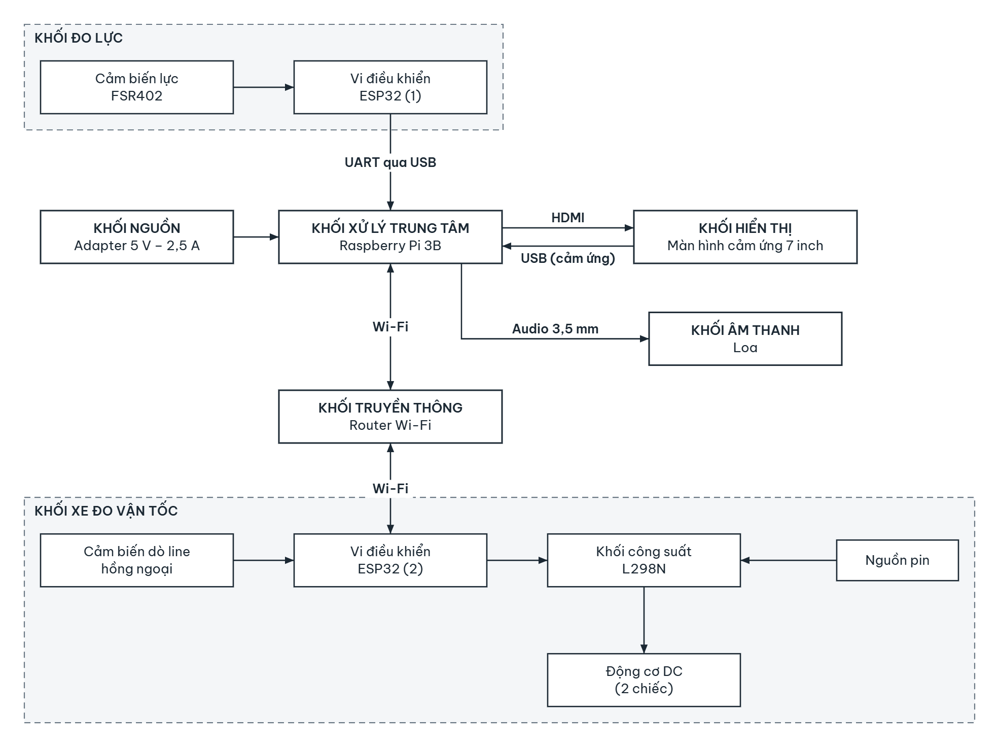
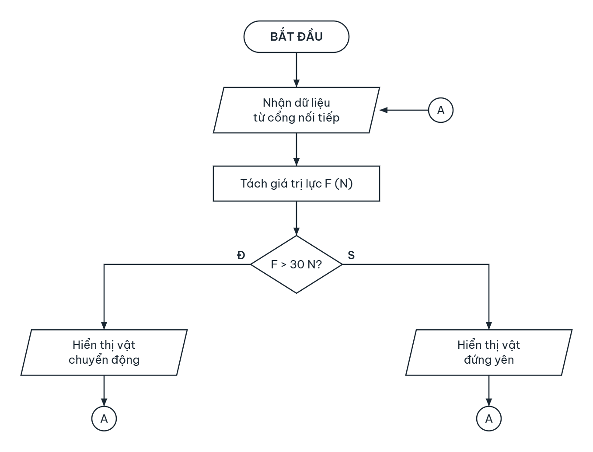
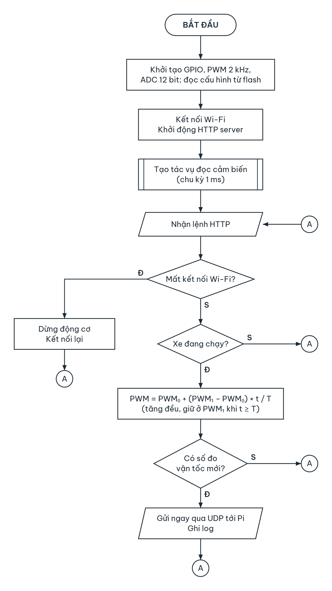

# Tài liệu hệ thống Phòng thí nghiệm Vật lý tương tác

Tài liệu mô tả toàn bộ thiết bị: phần cứng, phần mềm, giao thức truyền dữ liệu, giải thuật, cách cài đặt, vận hành và bảo trì. Nội dung được lập theo mã nguồn và cấu hình thiết bị ngày 24/11/2026, cập nhật ngày 26/11/2026.

## Mục lục

1. [Tổng quan](#1-tổng-quan)
2. [Sơ đồ khối tổng quát](#2-sơ-đồ-khối-tổng-quát)
3. [Phần cứng](#3-phần-cứng)
4. [Truyền thông giữa các khối](#4-truyền-thông-giữa-các-khối)
5. [Ngôn ngữ và phần mềm sử dụng](#5-ngôn-ngữ-và-phần-mềm-sử-dụng)
6. [Phần mềm trên Raspberry Pi](#6-phần-mềm-trên-raspberry-pi)
7. [Các bài học](#7-các-bài-học)
8. [Khởi động và vận hành](#8-khởi-động-và-vận-hành)
9. [Cài đặt và triển khai](#9-cài-đặt-và-triển-khai)
10. [Bảo trì và mở rộng](#10-bảo-trì-và-mở-rộng)
11. [Hiệu năng trên Raspberry Pi 3](#11-hiệu-năng-trên-raspberry-pi-3)
12. [Xử lý sự cố](#12-xử-lý-sự-cố)
13. [Tình trạng hiện tại](#13-tình-trạng-hiện-tại)
14. [Phụ lục](#14-phụ-lục)

---

## 1. Tổng quan

Thiết bị hỗ trợ dạy Vật lý lớp 10 bằng màn hình cảm ứng. Học sinh chơi trò chơi, đo lực bằng cảm biến và đo vận tốc bằng xe robot; số liệu đo hiển thị trực tiếp trên màn hình.

| Bài | Tên trên màn hình | Nội dung Vật lý | Nguồn dữ liệu |
|---|---|---|---|
| 1 | Khu vườn trên mây | Quãng đường, độ dịch chuyển, tốc độ và vận tốc trung bình | Trò chơi trên màn hình |
| 2 | Lực ma sát | Lực ma sát nghỉ, điều kiện để vật chuyển động | Cảm biến lực FSR402 qua USB, hoặc thanh trượt |
| 3 | Vận tốc | Vận tốc tại từng thời điểm, đồ thị v(t) | Xe robot ESP32 qua Wi-Fi, hoặc mô phỏng |
| 4 | Bài học mới | Chỗ trống cho mô-đun sau | – |

Thành phần chính:

- **Raspberry Pi 3B** chạy ứng dụng Electron, nối màn hình cảm ứng 7 inch và loa.
- **ESP32 (1)** đọc cảm biến lực FSR402, gửi lực cho Pi qua cáp USB.
- **ESP32 (2)** trên xe robot: đọc cảm biến dò line, điều khiển động cơ qua L298N, đo vận tốc và gửi cho Pi qua Wi-Fi.

---

## 2. Sơ đồ khối tổng quát

<!-- cach-doc-so-do -->
**Cách đọc các sơ đồ trong tài liệu.** Mỗi sơ đồ có phần *Giải thích cho học sinh* ngay bên dưới.

- **Sơ đồ khối** (Hình 1, 2): mỗi hình chữ nhật là một bộ phận, mũi tên cho biết dữ liệu hoặc điện đi từ đâu tới đâu. Mũi tên hai đầu: dữ liệu đi cả hai chiều.
- **Lưu đồ giải thuật** (Hình 3–9): đọc từ ô **BẮT ĐẦU**, đi theo mũi tên. Hình thoi là câu hỏi Đúng/Sai: đi theo nhánh **Đ** nếu đúng, nhánh **S** nếu sai. Hình bình hành là nhập hoặc xuất dữ liệu. Vòng tròn có chữ (A, B, C) là điểm nối: đi tiếp từ vòng tròn cùng chữ đang có mũi tên đi ra. Ký hiệu đầy đủ ở mục 14.1.
<!-- /cach-doc-so-do -->



*Hình 1. Sơ đồ khối tổng quát của hệ thống*

<!-- giai-thich:hardware -->
**Giải thích cho học sinh.** Hãy hình dung thiết bị như một nhóm làm thí nghiệm, mỗi khối giữ một việc.

1. **Khối xử lý trung tâm** (Raspberry Pi) là “bộ não”: nhận số liệu, tính toán, quyết định hiện gì lên màn hình.
2. **Khối hiển thị** là nơi học sinh nhìn và chạm. Mũi tên HDMI đi từ Pi sang màn hình (hình ảnh), mũi tên USB đi ngược lại (thao tác chạm).
3. **Khối âm thanh** chỉ nhận dữ liệu từ Pi nên mũi tên đi một chiều: Pi phát bài hát và giọng đọc ra loa.
4. **Khối đo lực**: tay ấn vào cảm biến FSR402, vi điều khiển ESP32 (1) đổi tín hiệu điện thành số niutơn (N), rồi gửi cho Pi qua dây USB.
5. **Khối xe đo vận tốc**: cảm biến dò line nhìn xuống sàn, ESP32 (2) phát hiện vạch đen, tính vận tốc và điều khiển hai động cơ qua mạch công suất L298N. Pin cấp điện riêng cho động cơ.
6. **Khối truyền thông** (Wi-Fi) nối xe với Pi không cần dây. Mũi tên hai đầu nghĩa là dữ liệu đi cả hai chiều: Pi gửi lệnh Bắt đầu/Dừng, xe gửi số đo vận tốc.

**Liên hệ Vật lý.** Thiết bị có hai “dụng cụ đo”: khối đo lực đo **lực** (đơn vị N), khối xe đo **thời gian** đi hết 10 cm để suy ra **vận tốc** (đơn vị m/s).

**Thử trả lời.** Vì sao mũi tên giữa khối âm thanh và Pi chỉ có một chiều, còn giữa Pi và khối truyền thông có hai chiều?

<details><summary>Xem đáp án</summary>Loa chỉ phát âm thanh, không gửi gì lại cho Pi. Còn Pi và xe vừa gửi lệnh, vừa nhận số đo nên cần hai chiều.</details>
<!-- /giai-thich -->


| Khối | Thành phần | Chức năng |
|---|---|---|
| Khối nguồn | Adapter 5 V – 2,5 A | Cấp nguồn cho Raspberry Pi và thiết bị USB |
| Khối xử lý trung tâm | Raspberry Pi 3B, RAM 1 GB | Chạy ứng dụng, xử lý dữ liệu đo, điều khiển xe qua HTTP |
| Khối hiển thị | Màn hình cảm ứng 7 inch (HDMI + USB) | Hiển thị bài học, nhận thao tác chạm |
| Khối âm thanh | Loa (jack 3,5 mm) | Phát bài hát và giọng đọc câu hỏi |
| Khối đo lực | FSR402, ESP32 (1) | Đo lực ấn 0–60 N, gửi qua UART |
| Khối xe đo vận tốc | Cảm biến dò line, ESP32 (2), L298N, 2 động cơ DC, pin | Đo thời gian qua các vạch đen cách nhau 10 cm, tính vận tốc |
| Khối truyền thông | Điểm phát Wi-Fi `iot` (mạng 192.168.137.x) | Mạng cục bộ giữa Pi và xe; không cần Internet khi học |

---

## 3. Phần cứng

### 3.1. Raspberry Pi

| Mục | Giá trị trên thiết bị hiện tại |
|---|---|
| Model | Raspberry Pi 3 Model B Rev 1.2 |
| Hệ điều hành | Raspberry Pi OS 13 (trixie), 32-bit `armv7l` |
| Tài khoản | `pap`, tự đăng nhập vào desktop |
| Thư mục ứng dụng | `/home/pap/Desktop/teach-physics` |
| Thẻ nhớ | 16 GB |
| Đồ họa | Chromium không dùng được GPU của Pi 3 (VC4 chỉ hỗ trợ OpenGL ES 2.0), mọi hình ảnh do CPU vẽ |

### 3.2. Khối đo lực

Mã nguồn: [touch-esp32/fsr402_uart/fsr402_uart.ino](../touch-esp32/fsr402_uart/fsr402_uart.ino)

Đấu nối:

- `3V3 → FSR402 → GPIO34`
- Điện trở 10 kΩ từ `GPIO34` xuống `GND`
- Cáp USB từ ESP32 vào Raspberry Pi: vừa cấp nguồn vừa truyền dữ liệu. Trên Pi cổng thường là `/dev/ttyUSB0`.

Thông số xử lý:

| Tham số | Giá trị | Ý nghĩa |
|---|---|---|
| `SEND_INTERVAL_MS` | 200 ms | Chu kỳ gửi (5 lần/giây) |
| `ADC_SAMPLES` | 16 | Số lần đọc ADC để lấy trung bình |
| Thang đo | ADC 0–4095 ↔ 0–60 N | ADC 12 bit đọc từ 0 đến 4095, ứng thẳng với lực 0–60 N: F = ADC / 4095 × 60 |
| `ADC_ZERO`, `ADC_SATURATION` | 20, 4090 | Hai đầu thang: ADC từ 20 trở xuống đọc là 0 N, từ 4090 trở lên đọc là 60 N |
| `FILTER_ALPHA` | 0,30 | Hệ số bộ lọc EMA |
| `UPDATE_DEADBAND_N` | 3 N | Chỉ cập nhật giá trị gửi khi lệch từ 3 N trở lên |
| `OUTPUT_STEP_N` | 0,5 N | Bước làm tròn |

Cách đọc lực: FSR402 đổi lực ấn thành điện áp, ESP32 đọc điện áp bằng ADC 12 bit được số từ 0 đến 4095. Thang 0–4095 ứng thẳng với thang lực 0–60 N, giống một thước đo có 4096 vạch chia đều: mỗi đơn vị ADC khoảng 0,015 N, ADC = 2048 là khoảng 30 N, ADC = 4095 là 60 N. `ADC_ZERO` và `ADC_SATURATION` là hai đầu của thang, có thể đặt theo từng cảm biến.

### 3.3. Xe đo vận tốc

Mã nguồn: [arduino/esp32_line_robot/esp32_line_robot.ino](../arduino/esp32_line_robot/esp32_line_robot.ino), hướng dẫn chi tiết tại [arduino/esp32_line_robot/README.md](../arduino/esp32_line_robot/README.md).

| L298N / cảm biến | ESP32 |
|---|---|
| ENA (PWM động cơ trái) | GPIO23 |
| IN1, IN2 | GPIO22, GPIO21 |
| IN3, IN4 | GPIO19, GPIO18 |
| ENB (PWM động cơ phải) | GPIO5 |
| A0 cảm biến dò line | GPIO34 (ADC1) |
| GND | Nối chung ESP32, L298N, cảm biến |

Lưu ý:

- Không dùng GPIO4 cho tín hiệu analog: GPIO4 thuộc ADC2, không đọc được ổn định khi Wi-Fi bật.
- Tháo jumper ENA/ENB trên L298N để ESP32 điều khiển PWM.
- Động cơ dùng nguồn pin riêng, không lấy từ chân 3V3 của ESP32.
- Đường đo gồm các vạch băng keo đen ngang cách nhau **10 cm**, rộng 1,5–2 cm, dán trên mặt bàn sáng màu. Xe chạy thẳng dọc dãy vạch; một cảm biến không tự lái theo đường cong.
- Cảm biến hiện cách mặt bàn khoảng 1 cm, không hạ thấp hơn được. Ở độ cao này băng đen chỉ cao hơn mặt bàn khoảng 130–170 đơn vị ADC, nên ngưỡng phải đặt theo số đo thực tế (mục 10.2).
- Xe không có encoder, vận tốc thực phụ thuộc pin và mặt sàn. Đó là lý do vận tốc được đo bằng vạch.

Thông số đang dùng (ngày 26/11/2026):

| Nhóm | Thông số | Giá trị |
|---|---|---|
| Wi-Fi | Tên mạng | `iot` |
| Cảm biến | Chân, kiểu đọc | GPIO34, analog 12 bit |
| | Ngưỡng ± vùng đệm | 85 ± 30: ADC > 115 là đen, ADC < 55 là trắng |
| | Chiều vạch đen | ADC cao hơn ngưỡng |
| | Không thấy mặt sàn | ADC > 1 500 (xe bị nhấc lên, ra ngoài mép bàn): không tính là vạch |
| Động cơ | PWM lúc bắt đầu → PWM tối đa | 60 → 160, tăng đều trong 8 s |
| Đo | Khoảng cách vạch | 0,10 m |
| | Khoảng cách tối thiểu giữa hai vạch | 40 ms (nhỏ hơn thì bỏ qua) |
| Dừng xe | | Chỉ khi bấm Dừng, hoặc khi mất Wi-Fi |

Ngưỡng cảm biến và thông số động cơ chỉnh được qua trang web của xe, lưu trong bộ nhớ flash (NVS) của ESP32, không cần nạp lại firmware (mục 10.2, 10.3). Nạp lại firmware không xóa các giá trị này.

Giá trị mặc định khi nạp firmware đặt trong `robot_config.h` (cạnh file `.ino`, không đưa lên Git vì chứa mật khẩu Wi-Fi):

```c
#pragma once
#define WIFI_SSID "iot"
#define WIFI_PASSWORD "mat-khau-wifi"

#define LINE_SENSOR_PIN 34
#define LINE_SENSOR_ANALOG 1
#define LINE_SENSOR_THRESHOLD 85
#define LINE_SENSOR_HYSTERESIS 30
#define LINE_SENSOR_FLOOR_MAX 1500
#define LINE_BLACK_BELOW_THRESHOLD 0   // 0: vạch đen cho ADC cao hơn ngưỡng
#define LINE_DIGITAL_BLACK_LOW 0

#define PWM_MIN 60
#define PWM_MAX 160
#define ACCELERATION_MS 8000
```

---

## 4. Truyền thông giữa các khối

| Kết nối | Giao thức | Dữ liệu | Chu kỳ |
|---|---|---|---|
| ESP32 (1) → Pi | UART qua USB, 115200 baud, mỗi dòng một giá trị | `value:32.50N` | 200 ms |
| Pi → ESP32 (2) | HTTP, cổng 80 | `POST /start`, `/stop`, `/reset` | Theo thao tác |
| ESP32 (2) → Pi | UDP, cổng 4210 trên Pi | Một gói JSON cho mỗi vạch đo được | Ngay khi qua vạch |
| ESP32 (2) → Pi | HTTP, cổng 80 | `GET /status?since=n`, phản hồi JSON (dự phòng khi mất gói UDP) | Pi hỏi mỗi 300 ms |
| ESP32 (2) → trình duyệt | HTTP, cổng 80 | Log, chẩn đoán, hiệu chuẩn (`/logs`, `/diag`, `/config`, `/motor`) | Theo yêu cầu |
| Cảm biến → ESP32 (2) | Analog GPIO34, ADC 12 bit | Mức đen/trắng | 1 ms |
| ESP32 (2) → L298N | PWM 2 kHz, 8 bit | Độ rộng xung 60–160 | 20 ms |

### 4.1. Cổng nối tiếp

Ứng dụng chấp nhận ba dạng dòng dữ liệu:

```text
value:32.50N                     ← định dạng của ESP32 (1)
{"type":"force","value":32.5}    ← JSON đầy đủ
32.5                             ← chỉ một số, được hiểu là lực (N)
```

Dòng không đúng định dạng được báo trên giao diện, không làm dừng ứng dụng. Nếu cổng chưa có thiết bị, ứng dụng thử mở lại sau mỗi 3 s.

### 4.2. HTTP của xe

| Lệnh | Chức năng |
|---|---|
| `POST /start` | Xóa số vạch, đặt mốc thời gian, cho động cơ chạy |
| `POST /stop` | Dừng động cơ, giữ số liệu |
| `POST /reset` | Dừng động cơ, xóa số vạch |
| `GET /status?since=n` | Trạng thái xe và các số đo có số thứ tự lớn hơn `n` |
| `GET /status?since=n&udp=4210` | Như trên, đồng thời đăng ký máy gửi yêu cầu nhận số đo qua UDP ở cổng 4210 |
| `GET /` | Trang điều khiển: nút Bắt đầu/Dừng/Đặt lại, bảng vạch, giá trị cảm biến, khung hiệu chuẩn và tăng tốc |
| `GET /logs` | Trang xem log trực tiếp (mục 10.4) |
| `GET /log?since=n`, `GET /log.json?since=n` | Log dạng văn bản và JSON |
| `GET /diag` | Chẩn đoán: lý do khởi động, RAM, Wi-Fi, cấu hình và giá trị cảm biến |
| `GET /config?threshold=&hysteresis=&floor=&black=` | Đọc hoặc đổi cấu hình cảm biến, lưu vào flash |
| `GET /motor?pwm_min=&pwm_max=&accel_ms=` | Đọc hoặc đổi thông số động cơ, lưu vào flash |
| `POST /reboot` | Khởi động lại ESP32 |

Ví dụ phản hồi `/status`:

```json
{"type":"speed","boot_id":184467,"seq":3,"value":1.237,"unit":"km/h","speed_mps":0.3436,
 "distance_m":0.40,"line_count":4,"line_spacing_m":0.100,"elapsed_s":1.62,"pwm":110,
 "running":true,"stop_reason":"","sensor_raw":18,"on_line":false,"log_seq":152,
 "events":[
  {"seq":2,"line":3,"t_s":1.181,"interval_s":0.3740,"speed_mps":0.2674,"speed_kmh":0.963},
  {"seq":3,"line":4,"t_s":1.472,"interval_s":0.2910,"speed_mps":0.3436,"speed_kmh":1.237}]}
```

- Mỗi phần tử `events` là một vạch: thời điểm `t_s`, khoảng thời gian `interval_s` tới vạch trước, vận tốc `speed_mps = 0,10 / interval_s`.
- Pi gửi kèm `since` là số thứ tự cuối đã nhận, nên không bỏ sót số đo nào. ESP32 giữ 64 số đo gần nhất.
- `boot_id` đổi khi ESP32 khởi động lại; Pi dựa vào đó để đọc lại từ đầu.
- Vận tốc được tính trên ESP32 tại thời điểm qua vạch, độ trễ mạng không ảnh hưởng kết quả.

Vì lý do an toàn, ứng dụng chỉ kết nối tới địa chỉ IP nội bộ (`10.x`, `172.16–31.x`, `192.168.x`, `169.254.x`) hoặc tên `.local`, và chờ tối đa 4 s cho mỗi yêu cầu.

### 4.3. Gửi ngay số đo qua UDP

Để vận tốc hiện lên ngay khi xe chạm vạch, không phải chờ lần hỏi kế tiếp (tới 300 ms):

1. Khi kết nối, Pi gọi `/status?since=0&udp=4210`. Xe ghi nhớ IP của Pi và cổng 4210, ghi log "Gửi ngay số đo vận tốc qua UDP tới …".
2. Mỗi khi đo xong một vạch, xe gửi ngay một gói UDP tới Pi:

   ```json
   {"type":"speed_event","boot_id":184467,"seq":3,"line":4,"t_s":1.472,"interval_s":0.2910,"speed_mps":0.3436,"speed_kmh":1.237}
   ```

3. Pi (`main.js`) nhận gói ở cổng 4210, chỉ chấp nhận gói đến từ đúng IP của xe, rồi chuyển cho Bài 3 qua kênh IPC `esp32:event`.
4. Bài 3 chỉ nhận gói có `seq` bằng số thứ tự cuối cùng + 1. Nếu một gói bị mất, lần hỏi `/status?since=n` kế tiếp lấy bù đủ, nên không bỏ sót vạch nào.

UDP không cần thêm thư viện: ESP32 dùng `WiFiUdp`, Pi dùng module `dgram` có sẵn trong Node.js. Trên Windows, tường lửa phải cho phép `electron.exe` nhận UDP; trên Raspberry Pi OS mặc định không chặn.

---

## 5. Ngôn ngữ và phần mềm sử dụng

### 5.1. Ngôn ngữ lập trình

| Ngôn ngữ | Dùng ở đâu | Quy mô |
|---|---|---|
| JavaScript (ES2020 trở lên) | Ứng dụng Electron: `src/main.js`, `src/preload.js`, các bài học trong `src/renderer/`; các script trong `scripts/` | khoảng 2 360 dòng |
| CSS3 | `src/renderer/styles.css`: bố cục Grid/Flexbox, biến CSS, hiệu ứng, khối chế độ nhẹ | khoảng 290 dòng |
| HTML5 | `src/renderer/index.html` là khung trang; giao diện từng bài được tạo bằng chuỗi HTML trong JavaScript | khoảng 20 dòng |
| C++ (Arduino) | Firmware ESP32: `esp32_line_robot.ino` (xe), `fsr402_uart.ino` (cảm biến lực) | khoảng 620 dòng |
| Bash | Lệnh quản trị trên Raspberry Pi: cập nhật mã, kiểm tra nguồn, bật/tắt dịch vụ | – |
| Python | Chỉ để chạy công cụ `edge-tts` tạo giọng đọc trên laptop; dự án không chứa mã Python | – |

Định dạng dữ liệu: JSON (phản hồi HTTP của xe, `package.json`), dòng văn bản qua UART (`value:32.50N`), Markdown (tài liệu), MP3 và WAV (âm thanh), SVG và PNG (hình ảnh).

Ứng dụng viết bằng JavaScript thuần, không dùng framework giao diện (React, Vue) và không dùng công cụ đóng gói (bundler). Sửa file xong, mở lại ứng dụng là thay đổi có hiệu lực, không cần bước build.

### 5.2. Nền tảng và thư viện của ứng dụng

| Thành phần | Phiên bản | Vai trò |
|---|---|---|
| Electron | 39.8.10 | Đóng gói Chromium và Node.js thành ứng dụng desktop. Bản 39 có sẵn binary cho Raspberry Pi OS 32-bit (`armv7l`) |
| Node.js | Laptop: 22 trở lên (đang dùng 24.11). Pi: 20 (gói của Raspberry Pi OS) | Chạy `npm` và script khởi động. Mã ứng dụng chạy trên Node.js tích hợp sẵn trong Electron |
| npm | Đi kèm Node.js | Cài gói, chạy các lệnh `npm start`, `npm run check`, `npm run voice` |
| serialport | 13.0.0 | Liệt kê cổng nối tiếp trong hộp thoại chọn cổng; mở cổng trên Windows. Trên Linux, ứng dụng cấu hình cổng bằng lệnh `stty` và đọc trực tiếp file thiết bị `/dev/ttyUSB0` |

API dùng trong giao diện (có sẵn trong Chromium):

| API | Dùng để |
|---|---|
| Canvas 2D | Vẽ đồ thị v(t) ở Bài 3 |
| SVG | Vẽ lại hành trình và mũi tên độ dịch chuyển ở Bài 1 |
| HTMLAudioElement | Phát bài hát và file giọng đọc MP3 |
| Web Audio API | Tiếng gieo xúc xắc |
| Web Speech API | Giọng đọc dự phòng khi thiếu file MP3 |

API dùng trong tiến trình chính (Node.js): `child_process` (gọi `stty`), `fs` (đọc cổng nối tiếp), `fetch` (gọi HTTP tới xe), `dgram` (nhận UDP từ xe), IPC của Electron (`ipcMain`, `contextBridge`). Giao diện dùng thêm `localStorage` để nhớ IP xe kết nối gần nhất.

### 5.3. Firmware ESP32

| Thành phần | Phiên bản | Vai trò |
|---|---|---|
| Arduino IDE | 2.3.8 | Soạn, biên dịch và nạp firmware |
| arduino-cli | 1.4.1 | Biên dịch bằng dòng lệnh, đi kèm Arduino IDE |
| Board package *esp32 by Espressif Systems* | 3.3.10 | Lõi Arduino cho ESP32, xây dựng trên ESP-IDF và hệ điều hành thời gian thực FreeRTOS |
| Thư viện | Có sẵn trong board package | `WiFi`, `WebServer` (HTTP server), `WiFiUdp` (gửi số đo qua UDP), `Preferences` (lưu cấu hình vào flash NVS), `esp_timer` (đồng hồ micro giây), `esp_random`, `esp_system` (lý do khởi động lại); FreeRTOS cho tác vụ đọc cảm biến 1 ms (`xTaskCreatePinnedToCore`) và hàng đợi (`xQueue`) chuyển sự kiện cảm biến sang vòng lặp chính để ghi log. Không cần cài thêm thư viện ngoài |

### 5.4. Hệ điều hành và dịch vụ trên Raspberry Pi

| Thành phần | Vai trò |
|---|---|
| Raspberry Pi OS 13 (trixie) 32-bit, nhân Linux 6.18 | Hệ điều hành |
| LightDM | Tự đăng nhập user `pap` khi bật máy |
| labwc | Trình quản lý cửa sổ Wayland; chạy các chương trình autostart |
| PipeWire | Âm thanh (loa 3,5 mm và HDMI) |
| NetworkManager | Kết nối Wi-Fi |
| OpenSSH server | Đăng nhập SSH; SFTP cho WinSCP |
| swayidle | Tắt màn hình sau 10 phút không chạm |
| Raspberry Pi Connect (`rpi-connect`) | Truy cập từ xa qua trình duyệt; hiện đang tắt (mục 9.5) |

### 5.5. Công cụ trên laptop

| Công cụ | Phiên bản đang dùng | Dùng để |
|---|---|---|
| Visual Studio Code | – | Soạn mã nguồn và tài liệu |
| Git | 2.51 | Quản lý phiên bản |
| GitHub | – | Lưu trữ mã nguồn: https://github.com/tuantran0707/teach-physics (công khai) |
| WinSCP | – | Chuyển file giữa laptop và Pi qua SFTP (mục 9.4) |
| PuTTY (`putty`, `plink`, `pscp`) | – | SSH, chạy lệnh và chép file bằng dòng lệnh |
| Python + `edge-tts` | 3.14, 7.3.1 | Tạo giọng đọc MP3 cho câu hỏi (`npm run voice`), giọng `vi-VN-HoaiMyNeural` |
| Raspberry Pi Imager | – | Ghi Raspberry Pi OS lên thẻ nhớ |

### 5.6. Tài nguyên bên ngoài

| Tài nguyên | Nguồn | Ghi chú |
|---|---|---|
| Hình Sóc Nâu, Robot (`assets/garden/squirrel.svg`, `robot.svg`) | OpenMoji | Giấy phép CC BY-SA 4.0, xem [TAI-SAN-HINH-ANH.md](TAI-SAN-HINH-ANH.md) |
| Giọng đọc câu hỏi (`assets/voice/*.mp3`) | Dịch vụ đọc văn bản của Microsoft, gọi qua `edge-tts` | Cần Internet lúc tạo; ứng dụng phát file đã tạo, không cần mạng |
| Bài hát, hình người đẩy xe | – | Nguồn chưa được ghi trong [TAI-SAN-HINH-ANH.md](TAI-SAN-HINH-ANH.md); cần bổ sung vì repo đang công khai |

---

## 6. Phần mềm trên Raspberry Pi

### 6.1. Cấu trúc mã nguồn

```text
teach-physics/
├── src/
│   ├── main.js                  Tiến trình chính: cửa sổ, cổng nối tiếp, HTTP tới xe
│   ├── preload.js               Cầu nối IPC, bật chế độ nhẹ trên Pi
│   └── renderer/
│       ├── index.html
│       ├── app.js               Trang chủ, hướng dẫn, bài hát, hộp thoại cảm biến
│       ├── styles.css           Giao diện, gồm khối CSS chế độ nhẹ (physics-lite)
│       ├── lessons/
│       │   ├── questions.js     Bộ 10 câu hỏi Bài 1 (dùng chung cho tạo giọng đọc)
│       │   ├── displacement.js  Bài 1: Khu vườn trên mây
│       │   ├── force.js         Bài 2: Lực ma sát
│       │   └── speed.js         Bài 3: Vận tốc
│       └── assets/
│           ├── garden/          Hình nhân vật, bài hát song.wav
│           ├── force/           Hình người đẩy xe
│           └── voice/           30 file MP3 giọng đọc câu hỏi
├── scripts/
│   ├── start-electron.js        Khởi chạy Electron (npm start)
│   ├── smoke-electron.js        Kiểm thử nhanh (npm run smoke)
│   └── generate-voice.js        Tạo giọng đọc (npm run voice)
├── arduino/esp32_line_robot/    Firmware xe: esp32_line_robot.ino, speed_event.h, README.md
│                                (robot_config.h tự tạo, không đưa lên Git)
├── touch-esp32/fsr402_uart/     Firmware cảm biến lực
├── deploy/                      File autostart mẫu
└── docs/                        Tài liệu và hình vẽ (so-do/)
```

### 6.2. Kiến trúc


*Hình 2. Sơ đồ khối phần mềm trên Raspberry Pi*

<!-- giai-thich:software -->
**Giải thích cho học sinh.** Phần mềm trên Pi chia ba lớp, giống một quán ăn có bếp, người phục vụ và bàn ăn.

1. **Tiến trình chính** là “nhà bếp”: làm việc trực tiếp với thiết bị thật, gồm mở cửa sổ, đọc cảm biến lực qua cổng USB, nói chuyện với xe qua Wi-Fi (HTTP và UDP).
2. **Lớp trung gian** là “người phục vụ”: chuyển dữ liệu giữa bếp và bàn ăn qua một cầu nối duy nhất. Giao diện không được tự vào bếp, nhờ vậy an toàn hơn.
3. **Giao diện** là “bàn ăn”: trang chủ và ba bài học mà học sinh nhìn thấy. Từ trang chủ chọn Bài 1, 2 hoặc 3; Bài 1 lấy thêm hình ảnh, âm thanh trong thư mục tài nguyên.
4. Đọc theo mũi tên: số đo từ cảm biến đi từ trên xuống (bếp → người phục vụ → bàn ăn). Lệnh của học sinh (bấm Bắt đầu) đi ngược lên, nên một số mũi tên có hai đầu.

**Thử trả lời.** Khi học sinh bấm “Bắt đầu” ở Bài 3, lệnh đi qua những lớp nào để tới xe?

<details><summary>Xem đáp án</summary>Giao diện (Bài 3) → lớp trung gian (cầu nối IPC) → tiến trình chính (giao tiếp HTTP) → xe ESP32 (2).</details>
<!-- /giai-thich -->


- **Tiến trình chính** (`main.js`, Node.js) giữ quyền truy cập phần cứng: mở cổng nối tiếp, gọi HTTP tới xe, tạo cửa sổ toàn màn hình trên Pi.
- **Lớp trung gian** (`preload.js`) cung cấp đối tượng `window.physicsBridge`. Giao diện không chạy Node.js (`contextIsolation: true`, `nodeIntegration: false`).
- **Giao diện** gồm trang chủ và các bài học. Mỗi bài là một mô-đun có hàm `mount()` trả về hàm dọn dẹp khi rời bài.

Các kênh IPC:

| Kênh | Hướng | Nội dung |
|---|---|---|
| `serial:list`, `serial:connect`, `serial:disconnect` | Giao diện → chính | Liệt kê, mở, đóng cổng nối tiếp |
| `sensor:data` | Chính → giao diện | `{ type: 'force', value }` |
| `sensor:connection`, `sensor:error`, `sensor:warning` | Chính → giao diện | Trạng thái và lỗi cổng nối tiếp |
| `esp32:connect`, `esp32:status`, `esp32:command`, `esp32:disconnect` | Giao diện → chính | Kết nối, đọc trạng thái, gửi lệnh tới xe |
| `esp32:event` | Chính → giao diện | Số đo một vạch, nhận qua UDP |

### 6.3. Chế độ nhẹ

Trên Linux ARM, `main.js` truyền cờ `--physics-lite`, `preload.js` gắn class `physics-lite` vào thẻ `<html>`. Khối CSS tương ứng tắt blur nền, bóng đổ và các animation trang trí lặp vô hạn, nhưng giữ các chuyển động có ý nghĩa vật lý (xe chạy, đường cuộn). Ép bật/tắt bằng biến môi trường `PHYSICS_LITE=1` hoặc `PHYSICS_LITE=0`.

---

## 7. Các bài học

### 7.1. Bài 1: Khu vườn trên mây

Trước khi vào trò chơi, màn hình phát bài hát **Khỉ Vàng và Voi Lam** kèm lời chạy theo nhạc, giới thiệu khái niệm quãng đường, tốc độ, độ dịch chuyển, vận tốc.

Luật chơi:

- Bản đồ 13 × 9 ô, mỗi ô 1 m. Hang Sóc là điểm xuất phát, Hội chợ ở góc trên bên phải.
- Có 4 loại quả (táo, cam, nho, dâu), mỗi loại 3 cây; 8 chướng ngại vật (bùn, bụi gai, hố sâu). Bản đồ sinh ngẫu nhiên và luôn được kiểm tra có đường đi. Nút **Đổi bản đồ** dùng được trước nước đi đầu tiên.
- Đối thủ: **Robot** (máy tự tìm đường ngắn nhất bằng BFS) hoặc **học sinh thứ hai**.
- Mỗi lượt gieo xúc xắc 1–6, rồi vạch đường bằng các nút Bắc/Nam/Đông/Tây (hoặc phím mũi tên, Backspace để xóa, Enter để đi). Khi đường vạch chạm Hội chợ thì dừng tại đó, không cần đi hết số bước.
- Gặp cây có loại quả chưa hái: trả lời câu hỏi Vật lý, đúng thì hái được quả. Gặp chướng ngại: mất lượt.
- Hái đủ **3 loại quả** rồi tới Hội chợ thì thắng. Cổng Hội chợ chặn người chơi chưa đủ quả.

Câu hỏi và giọng đọc:

- 10 câu trong [src/renderer/lessons/questions.js](../src/renderer/lessons/questions.js), bốc theo bộ đã xáo: hỏi hết 10 câu mới lặp lại.
- Máy tự đọc câu hỏi và các đáp án bằng giọng AI tiếng Việt (giọng HoaiMy), nút 🔊 Nghe để đọc lại. Sau khi chọn, máy đọc "Chính xác!" hoặc "Chưa đúng." kèm lời giải thích.
- Giọng đọc là 30 file MP3 trong `assets/voice/` (mỗi câu 3 file: câu hỏi, khi đúng, khi sai). Không cần mạng khi chạy.

Kết thúc ván: trò chơi vẽ lại hành trình (đường xanh là quãng đường s, mũi tên tím là độ dịch chuyển d), rồi hiện bảng so sánh s với d, tốc độ trung bình s/t với vận tốc trung bình d/t, kèm hướng của độ dịch chuyển. Nút **Xem lại quá trình** chạy lại hoạt hình; nút **Quay lại kết quả** trở về bảng so sánh.


*Hình 8. Lưu đồ một lượt chơi trong Bài 1*

<!-- giai-thich:game -->
**Giải thích cho học sinh.** Lưu đồ mô tả một lượt chơi của Bài 1: Khu vườn trên mây.

1. Gieo xúc xắc được n bước. Nếu là lượt của máy (Robot), máy tự tìm đường ngắn nhất; nếu là học sinh, học sinh chọn hướng Bắc/Nam/Đông/Tây cho đủ n bước (hoặc dừng sớm khi chạm Hội chợ).
2. Trước mỗi bước, kiểm tra ô tiếp theo: nếu là Hội chợ mà chưa đủ 3 loại quả thì bị chặn, chuyển lượt.
3. Đi 1 ô thì **quãng đường s tăng thêm 1 m**.
4. Gặp ô có quả chưa hái: trả lời câu hỏi Vật lý; trả lời đúng thì được bỏ quả vào giỏ.
5. Tới Hội chợ với đủ 3 loại quả thì **thắng**, xem kết quả. Gặp chướng ngại (bùn, gai, hố) thì mất lượt. Còn bước thì đi tiếp (điểm nối B), hết bước thì chuyển lượt (điểm nối A).

**Liên hệ Vật lý.** Cuối ván, trò chơi so sánh **quãng đường s** (tổng số mét đã đi, theo đường vòng) với **độ dịch chuyển d** (đoạn thẳng có hướng từ Hang Sóc tới Hội chợ). Luôn có s ≥ d, và **tốc độ trung bình s/t** luôn lớn hơn hoặc bằng **độ lớn vận tốc trung bình d/t**.

**Thử trả lời.** Sóc đi 3 ô về Đông rồi 4 ô về Bắc. Quãng đường và độ dịch chuyển bằng bao nhiêu?

<details><summary>Xem đáp án</summary>s = 3 + 4 = 7 m; d = √(3² + 4²) = 5 m, hướng Đông–Bắc.</details>
<!-- /giai-thich -->


### 7.2. Bài 2: Lực ma sát

Mô hình: vật có trọng lực P = 50 N, phản lực N = 50 N, lực ma sát nghỉ cực đại 30 N. Lực kéo lấy từ cảm biến FSR402 hoặc thanh trượt 0–60 N. Khi lực kéo lớn hơn 30 N, vật chuyển động, lực càng lớn xe chạy càng nhanh. Nút ẩn/hiện số liệu giúp học sinh tự dự đoán trước khi xem.


*Hình 6. Lưu đồ đo lực trên ESP32 (1)*

<!-- giai-thich:force -->
**Giải thích cho học sinh.** Đây là việc ESP32 (1) làm mỗi 0,2 giây: đọc cảm biến lực và gửi số niutơn cho Pi.

1. Cảm biến FSR402 đổi lực ấn thành điện áp. ESP32 đọc điện áp bằng bộ chuyển đổi **ADC 12 bit**, cho ra một số nguyên từ **0 đến 4095**. Tay càng ấn mạnh, số ADC càng lớn.
2. Đọc **16 lần rồi lấy trung bình**, giống đo nhiều lần rồi lấy trung bình trong giờ thực hành.
3. Thang ADC **0–4095** ứng với thang lực **0–60 N** theo đường thẳng: **F = ADC / 4095 × 60**. ADC = 0 là 0 N, ADC = 4095 là 60 N, mỗi đơn vị ADC bằng khoảng 0,015 N. Ví dụ ADC = 2048 thì F ≈ 30 N.
4. **Làm mượt:** F₁ = F₁ + 0,3 × (F − F₁). Số đo mới chỉ “kéo” F₁ đi 30% về phía nó, nên số trên màn hình chuyển đều khi tay hơi run. Khi tay thả ra (F = 0), F₁ về 0 ngay.
5. Số gửi đi (F₂) đổi khi lực thay đổi **từ 3 N trở lên**, làm tròn tới 0,5 N. Gửi cho Pi qua dây USB dạng `value:30.00N`, rồi quay lại chờ chu kỳ tiếp theo (vòng tròn A).

**Liên hệ Vật lý.** Đơn vị lực là **niutơn (N)**. Lực F tỉ lệ thuận với số ADC: số ADC tăng gấp đôi thì lực tăng gấp đôi. Đây giống như đọc một thước đo có 4096 vạch chia, trải đều từ 0 đến 60 N.

**Thử trả lời.** Cảm biến đọc được ADC = 1365. Lực bằng bao nhiêu niutơn?

<details><summary>Xem đáp án</summary>F = 1365 / 4095 × 60 = 20 N.</details>
<!-- /giai-thich -->




*Hình 7. Lưu đồ xử lý dữ liệu lực trong Bài 2*

<!-- giai-thich:forceLesson -->
**Giải thích cho học sinh.** Bài 2 so sánh lực kéo với lực ma sát nghỉ cực đại để biết vật đứng yên hay chuyển động.

1. Pi nhận một dòng dữ liệu từ cảm biến lực và tách ra con số F (N).
2. So sánh: **F có lớn hơn 30 N không?** 30 N là lực ma sát nghỉ cực đại của vật trong bài.
3. Nếu **có**: lực kéo thắng ma sát, vật **chuyển động**; lực càng lớn, vật chạy càng nhanh.
4. Nếu **không**: lực ma sát nghỉ cân bằng với lực kéo, vật **đứng yên**.
5. Vòng tròn A: lặp lại với dòng dữ liệu tiếp theo (5 lần mỗi giây).

**Liên hệ Vật lý.** Lực ma sát nghỉ luôn bằng lực kéo khi vật đứng yên, nhưng không thể vượt quá giá trị cực đại (ở đây 30 N). Khi lực kéo lớn hơn giá trị này, vật bắt đầu trượt.

**Thử trả lời.** Kéo vật bằng lực 25 N thì lực ma sát nghỉ lúc đó bằng bao nhiêu?

<details><summary>Xem đáp án</summary>25 N, vì vật đứng yên nên ma sát nghỉ cân bằng đúng với lực kéo.</details>
<!-- /giai-thich -->


### 7.3. Bài 3: Vận tốc

Hai chế độ:

- **Mô phỏng** (chưa kết nối xe): một hành trình mẫu tăng tốc, chạy đều rồi giảm tốc, mỗi giây một điểm, đơn vị km/h.
- **Xe thật**: nhấn **📶 Kết nối xe**. Ô IP điền sẵn `192.168.137.35` (hoặc IP kết nối thành công gần nhất); nếu cần sửa, dùng **bàn phím số trên màn hình** trong hộp thoại (0–9, dấu chấm, ⌫, Xóa hết, Mặc định). Bấm **Kết nối**, rồi **▶ Bắt đầu**. Đồng hồ, đồ thị và bảng chuyển sang m/s. Mỗi dòng bảng là một vạch: Vạch, Thời điểm t, Δt giữa hai vạch, v = 0,1 m ÷ Δt. Trục đồ thị tự co giãn theo vận tốc lớn nhất.

Nguyên lý đo: xe qua vạch thứ nhất thì bắt đầu tính giờ. Từ vạch thứ hai, mỗi vạch cho một số đo v = 0,10 m ÷ Δt, là vận tốc trung bình trên đoạn 10 cm vừa đi, xấp xỉ vận tốc tức thời tại vạch. Số đo được gửi ngay qua UDP nên hiện trên màn hình gần như cùng lúc xe chạm vạch (mục 4.3).

Chuyển động của xe:

- Xe **chỉ chạy khi bấm Bắt đầu và chỉ dừng khi bấm Dừng**; không tự dừng khi hết vạch. Chỉ khi mất Wi-Fi xe mới tự dừng để an toàn, vì lúc đó Pi không gửi được lệnh Dừng.
- Xe **chạy chậm rồi nhanh dần đều**: PWM tăng tuyến tính từ 60 lên 160 trong 8 s rồi giữ nguyên. Ở PWM thấp, động cơ cần 1–3 s mới đủ lực để lăn; việc tính giờ bắt đầu từ vạch đầu tiên nên không ảnh hưởng phép đo.

Kết quả một lần chạy thật (26/11/2026, ngưỡng 85 ± 30):

| Vạch | t (s) | Δt (s) | v (m/s) |
|---|---|---|---|
| 2 | 0,856 | 0,267 | 0,375 |
| 3 | 1,086 | 0,230 | 0,435 |
| 4 | 1,296 | 0,210 | 0,476 |

Vận tốc tăng đều qua từng vạch, phù hợp với chuyển động nhanh dần.


*Hình 3. Lưu đồ tác vụ đọc cảm biến dò line*

<!-- giai-thich:sensorTask -->
**Giải thích cho học sinh.** Đây là việc ESP32 trên xe làm lặp đi lặp lại **1 000 lần mỗi giây**: nhìn xuống sàn và quyết định đang ở trên vạch đen hay mặt bàn.

1. Mỗi 1 ms, đọc một giá trị ADC từ cảm biến. Băng đen phản xạ ít ánh sáng hồng ngoại nên cho số lớn (khoảng 145–191); mặt bàn sáng cho số nhỏ (khoảng 16–30). Số quá lớn (trên 1 500) nghĩa là xe bị nhấc lên, không tính.
2. **Nhánh trái (đang ở mặt bàn):** gặp mẫu đen thì đếm k. Phải **đen 3 lần liên tiếp** mới tin là vạch thật, để không bị lừa bởi một hạt bụi hay vết bẩn. Thời điểm của mẫu đen **đầu tiên** được ghi lại là t₀.
3. Khi đã chắc chắn là vạch: tăng số vạch N lên 1. Nếu đây là **vạch đầu tiên**, chỉ bấm “đồng hồ bấm giờ”. Từ **vạch thứ hai**, tính Δt = t₀ − t₁ (thời gian đi giữa hai vạch) và v = 0,1 / Δt.
4. Lưu số đo, rồi lấy t₀ làm mốc t₁ cho vạch sau.
5. **Nhánh phải (đang ở trên vạch):** phải thấy **trắng 5 lần liên tiếp** mới coi là đã ra khỏi vạch. Nhờ vậy một vạch không bị đếm hai lần.
6. Vòng tròn **A** nghĩa là quay lại bước “Chờ chu kỳ 1 ms” để đọc mẫu tiếp theo.

**Liên hệ Vật lý.** Đây chính là cách đo vận tốc trung bình **v = s / t** với s = 0,1 m cố định. Ví dụ xe qua vạch 3 lúc 1,086 s và vạch 4 lúc 1,296 s: Δt = 0,210 s, v = 0,1 / 0,210 ≈ 0,48 m/s. Vì đoạn 10 cm rất ngắn, số đo này gần bằng vận tốc tức thời của xe tại vạch.

**Thử trả lời.** Nếu xe qua hai vạch liên tiếp cách nhau 0,25 s thì vận tốc là bao nhiêu?

<details><summary>Xem đáp án</summary>v = 0,1 m / 0,25 s = 0,4 m/s.</details>
<!-- /giai-thich -->


Tác vụ này chạy riêng mỗi 1 ms với mức ưu tiên cao hơn web server, nên việc Pi hỏi dữ liệu không làm lệch thời điểm qua vạch. Mỗi mẫu ADC được phân loại:

| Điều kiện | Kết quả |
|---|---|
| ADC > 1 500 | Trắng: cảm biến không thấy mặt sàn (xe bị nhấc lên, ra ngoài mép bàn), không tính là vạch |
| ADC > ngưỡng + vùng đệm (115) | Đen |
| ADC < ngưỡng − vùng đệm (55) | Trắng |
| Ở giữa (55–115) | Vùng đệm: giữ trạng thái cũ, chống nhấp nháy ở mép băng keo |

Một vạch được xác nhận khi đọc 3 mẫu đen liên tiếp; xe ra khỏi vạch khi đọc 5 mẫu trắng liên tiếp. Thời điểm qua vạch lấy từ mẫu đen đầu tiên, đo bằng đồng hồ micro giây. Hai vạch cách nhau dưới 40 ms bị bỏ qua (thường là một vạch bị đếm hai lần ở mép).



*Hình 4. Lưu đồ chương trình chính của xe*

<!-- giai-thich:carLoop -->
**Giải thích cho học sinh.** Trong khi tác vụ ở Hình 3 lo đọc cảm biến, chương trình chính của xe lo **nghe lệnh, điều khiển động cơ và báo kết quả**.

1. Khi bật nguồn: chuẩn bị các chân điều khiển, đọc cấu hình đã lưu (ngưỡng cảm biến, tốc độ), kết nối Wi-Fi rồi khởi động tác vụ đọc cảm biến (khung có hai vạch đứng là một chương trình con chạy song song).
2. Vòng lặp chính bắt đầu ở “Nhận lệnh HTTP”: nghe xem Pi có bấm Bắt đầu, Dừng hay Đặt lại không.
3. **Mất Wi-Fi?** Nếu mất thì dừng động cơ ngay, vì lúc đó Pi không thể gửi lệnh Dừng nữa. Đây là quy tắc an toàn.
4. **Xe đang chạy?** Nếu đang chạy, tính lại PWM (mức điện cấp cho động cơ) theo công thức PWM = PWM₀ + (PWM₁ − PWM₀) × t / T: PWM tăng **đều đặn** theo thời gian, từ 60 lên 160 trong 8 giây.
5. **Có số đo vận tốc mới?** Nếu tác vụ cảm biến vừa đo xong một vạch, gửi ngay cho Pi qua UDP và ghi vào nhật ký (log).
6. Vòng tròn **A** đưa về đầu vòng lặp. Xe chỉ dừng khi nhận lệnh Dừng (hoặc mất Wi-Fi).

**Liên hệ Vật lý.** PWM tăng đều làm lực kéo của động cơ tăng dần, nên xe **chạy chậm rồi nhanh dần**. Học sinh quan sát được điều này trong bảng: vận tốc tại các vạch sau lớn hơn vạch trước (ví dụ 0,375 → 0,435 → 0,476 m/s).

**Thử trả lời.** Vì sao xe phải tự dừng khi mất Wi-Fi, trong khi bình thường chỉ dừng khi bấm nút?

<details><summary>Xem đáp án</summary>Vì mất Wi-Fi thì lệnh Dừng từ Pi không tới được xe; nếu không tự dừng, xe sẽ chạy mãi và có thể rơi khỏi bàn.</details>
<!-- /giai-thich -->


Trong công thức của Hình 4: PWM₀ là PWM lúc bắt đầu (60), PWM₁ là PWM tối đa (160), T là thời gian tăng tốc (8 s), t là thời gian từ lúc bấm Bắt đầu.


*Hình 5. Lưu đồ nhận số đo vận tốc trên Raspberry Pi*

<!-- giai-thich:speedLesson -->
**Giải thích cho học sinh.** Đây là việc ứng dụng trên Pi làm ở Bài 3 để nhận số đo từ xe và hiện lên bảng.

1. Chọn IP của xe (đã điền sẵn 192.168.137.35) và kết nối. Pi hỏi trạng thái xe và **đăng ký nhận tin nhanh** qua UDP.
2. Nếu xe không trả lời đúng, báo lỗi và quay lại cho nhập IP. Nếu đúng, ghi nhớ số thứ tự n của số đo mới nhất.
3. Bấm **Bắt đầu**: Pi gửi lệnh cho xe chạy.
4. Pi chờ: hoặc xe gửi tin nhanh (gói UDP) khi vừa qua vạch, hoặc hết 300 ms.
5. Mỗi số đo có **số thứ tự** như số trang sách. Nếu gói vừa nhận đúng là số n + 1 (số tiếp theo), thêm ngay vào bảng. Nếu không có gói, hoặc bị nhảy số (mất một gói), Pi hỏi lại xe “cho tôi các số đo sau số n” để lấy bù.
6. Thêm dòng vào bảng và đồ thị v(t), cập nhật n. Lặp lại tới khi xe dừng.

**Liên hệ Vật lý.** Mỗi dòng của bảng là một điểm trên **đồ thị vận tốc theo thời gian v(t)**. Nếu các điểm nằm gần một đường thẳng đi lên, xe đang chuyển động **nhanh dần đều**.

**Thử trả lời.** Pi đã có số đo số 6, rồi nhận được gói số 8. Pi làm gì?

<details><summary>Xem đáp án</summary>Gói số 8 không liền sau số 6 (thiếu số 7), nên Pi bỏ qua gói đó và hỏi xe các số đo sau số 6; xe gửi lại cả số 7 và số 8.</details>
<!-- /giai-thich -->


---

## 8. Khởi động và vận hành


*Hình 9. Lưu đồ khởi động hệ thống*

<!-- giai-thich:boot -->
**Giải thích cho học sinh.** Lưu đồ cho biết điều gì xảy ra từ lúc cắm điện cho tới khi màn hình hiện bài học, không cần bàn phím hay chuột.

1. Bật nguồn, Raspberry Pi OS khởi động và **tự đăng nhập**.
2. Ứng dụng tự chạy. Nếu thiết bị là Raspberry Pi, bật chế độ đồ họa rút gọn để chạy mượt hơn.
3. Trang chủ hiện ra với các bài học.
4. Ứng dụng thử mở cổng của cảm biến lực. Chưa được (chưa cắm cảm biến) thì chờ 3 giây rồi thử lại, cứ thế cho tới khi kết nối được.
5. Kết nối xong thì bắt đầu nhận dữ liệu lực cho Bài 2.

**Thử trả lời.** Nếu cắm cảm biến lực sau khi ứng dụng đã mở 1 phút, ứng dụng có nhận được không?

<details><summary>Xem đáp án</summary>Có. Ứng dụng thử kết nối lại mỗi 3 giây, nên sẽ tự nhận khi cảm biến được cắm vào.</details>
<!-- /giai-thich -->


Khi cấp nguồn:

1. Raspberry Pi OS khởi động vào chế độ đồ họa.
2. LightDM tự đăng nhập user `pap` vào phiên `labwc`.
3. `labwc` chạy các mục autostart, trong đó có `~/.config/autostart/vat-ly-tuong-tac.desktop` (lệnh `npm start --prefix /home/pap/Desktop/teach-physics`).
4. Ứng dụng mở toàn màn hình, bật chế độ nhẹ, tự kết nối cảm biến lực ở `/dev/ttyUSB0`.

Cấu hình đang áp dụng trên Pi:

| Mục | Trạng thái | Bật lại / tắt lại |
|---|---|---|
| Bluetooth | Tắt (dịch vụ tắt, sóng bị chặn) | Bật: `sudo rfkill unblock bluetooth && sudo systemctl enable --now bluetooth` |
| Raspberry Pi Connect (điều khiển từ xa) | Tắt | Bật, tắt và cách dùng: mục 9.5 |
| Tắt màn hình khi không chạm | Sau 10 phút (`swayidle` trong `~/.config/labwc/autostart`) | Xóa dòng `swayidle` để màn hình luôn sáng |
| SSH | Bật | Dùng để cập nhật mã nguồn từ máy tính |

Tắt hẳn ứng dụng: chạm biểu tượng thoát nếu có, hoặc qua SSH chạy `pkill -f teach-physics/node_modules/electron`. Khởi động lại Pi thì ứng dụng tự mở lại. Khi mở lại ứng dụng bằng tay qua SSH, kiểm tra không còn bản cũ chạy song song: `pgrep -fa 'dist/electron \.'` chỉ được ra một dòng.

### Mạng Wi-Fi khi sử dụng

| Thiết bị | Mạng | Địa chỉ IP (26/11/2026) |
|---|---|---|
| Điểm phát Wi-Fi | `iot` | 192.168.137.1 |
| Raspberry Pi | `iot` | 192.168.137.218 |
| Xe ESP32 (2) | `iot` | 192.168.137.35 |
| Laptop (khi cần cập nhật hoặc đọc log) | `iot` | do điểm phát cấp |

Các địa chỉ do điểm phát cấp tự động (DHCP) nên có thể đổi khi đổi điểm phát. Cách tìm lại:

- IP của xe: dòng log "Wi-Fi: nhận IP …" trong Serial Monitor (cắm USB, 115200 baud) hoặc trang quản trị điểm phát.
- IP của Pi: `hostname -I` trên Pi, hoặc trang quản trị điểm phát (Raspberry Pi có địa chỉ MAC bắt đầu bằng `b8:27:eb`).

Trình tự một buổi học dùng xe:

1. Bật điểm phát Wi-Fi `iot`, bật Pi, chờ ứng dụng mở.
2. Bật nguồn xe, chờ khoảng 5 s để xe vào Wi-Fi.
3. Trên Pi: **Bài 3 → 📶 Kết nối xe → Kết nối** (IP điền sẵn).
4. Đặt cảm biến xe trên mặt bàn, trước vạch đầu tiên 3–5 cm. Bấm **▶ Bắt đầu**, chờ xe tự lăn, bấm **■ Dừng** khi xe qua hết các vạch.

---

## 9. Cài đặt và triển khai

### 9.1. Chạy trên máy tính

Yêu cầu Node.js 22 trở lên.

```bash
npm install
npm start          # chạy ứng dụng
npm run dev        # chạy kèm DevTools
npm run check      # kiểm tra cú pháp
npm run smoke      # kiểm thử nhanh giao diện
```

### 9.2. Cài mới trên Raspberry Pi

Xem các bước chi tiết trong [README.md](../README.md#cài-trên-raspberry-pi-3b-hoặc-4): cài Node.js và thư viện hệ thống, chép mã nguồn, chạy `npm install` **trên Pi** (không chép `node_modules` từ Windows), rồi chép `deploy/vat-ly-tuong-tac.desktop` vào `~/.config/autostart/` và sửa đường dẫn.

### 9.3. Chuyển code từ laptop lên Raspberry Pi

Chọn cách theo vị trí của laptop:

| Cách | Khi nào dùng | Yêu cầu |
|---|---|---|
| WinSCP (mục 9.4) | Laptop và Pi cùng một mạng Wi-Fi/LAN. Chép vài file vừa sửa hoặc đồng bộ cả thư mục | SSH đang bật trên Pi (mặc định đã bật), biết địa chỉ IP của Pi |
| Raspberry Pi Connect (mục 9.5) | Laptop ở xa, khác mạng với Pi | Pi có Internet, đã bật Connect và liên kết tài khoản Raspberry Pi ID; code đã đẩy lên GitHub |
| PuTTY `pscp` | Chép nhanh một vài file bằng dòng lệnh | Như WinSCP |

Nguyên tắc chung cho mọi cách:

1. Kiểm tra trên laptop trước khi chép: `npm run check`.
2. Chỉ chép mã nguồn và tài nguyên: `src/`, `scripts/`, `package.json`, `package-lock.json`. Thư mục dự án trên Pi là `/home/pap/Desktop/teach-physics`.
3. **Không chép `node_modules/`.** Thư mục này trên laptop chứa Electron bản Windows, chép sang Pi sẽ gây lỗi `EACCES` khi chạy. Không cần chép `.git/`, `arduino/`, `touch-esp32/` (firmware được nạp từ laptop qua cáp USB).
4. Giữ nguyên cấu trúc thư mục: `src/renderer/lessons/speed.js` trên laptop phải nằm đúng `/home/pap/Desktop/teach-physics/src/renderer/lessons/speed.js` trên Pi.
5. Sao lưu bản đang chạy trên Pi trước khi ghi đè.
6. Nếu phần `dependencies` trong `package.json` thay đổi, chạy `npm install` trên Pi (cần Internet, mất vài phút trên Pi 3).
7. Ứng dụng chỉ đọc file lúc khởi động. Sau khi chép, khởi động lại Pi (`sudo reboot`, nhập mật khẩu của user `pap`); ứng dụng tự mở lại sau khoảng 1 phút.

Cách nhanh bằng dòng lệnh, từ PowerShell trên laptop đã cài PuTTY:

```powershell
pscp src\renderer\lessons\speed.js pap@<ip-pi>:/home/pap/Desktop/teach-physics/src/renderer/lessons/
```

### 9.4. Chuyển code bằng WinSCP

WinSCP là phần mềm miễn phí trên Windows, chép file qua giao thức SFTP (chạy trên SSH). Tải tại https://winscp.net.

**Bước 1. Lấy địa chỉ IP của Pi.** Trên Pi mở Terminal và chạy `hostname -I`, hoặc xem danh sách thiết bị trong trang quản trị của router.

**Bước 2. Tạo kết nối.** Mở WinSCP, trong cửa sổ **Login** chọn **New Site** và điền:

| Trường | Giá trị |
|---|---|
| File protocol | SFTP |
| Host name | IP của Pi, hiện là `192.168.137.218` (mạng `iot`) |
| Port number | 22 |
| User name | `pap` |
| Password | Mật khẩu của user `pap` |

Nhấn **Save** để lưu kết nối (không tích lưu mật khẩu nếu laptop dùng chung), rồi nhấn **Login**.

**Bước 3. Xác nhận khóa của Pi (lần đầu).** WinSCP hỏi *Continue connecting to an unknown server and add its host key to a cache?* và hiện một mã `SHA256:...`. Trên Pi chạy:

```bash
ssh-keygen -lf /etc/ssh/ssh_host_ed25519_key.pub
```

Hai mã trùng nhau thì chọn **Accept**. Về sau, nếu WinSCP báo khóa thay đổi trong khi Pi không cài lại hệ điều hành, dừng lại và kiểm tra trước khi tiếp tục.

**Bước 4. Mở đúng thư mục.** Ở giao diện hai khung, khung trái là laptop, khung phải là Pi. Khung trái mở thư mục dự án trên laptop; khung phải mở `/home/pap/Desktop/teach-physics`.

**Bước 5. Sao lưu.** Kéo thư mục `src` từ khung phải sang một thư mục sao lưu trên laptop, ví dụ `backup-pi-2026-11-25`.

**Bước 6a. Chép vài file.** Mở cùng một thư mục con ở hai khung (ví dụ `src/renderer/lessons`), chọn file ở khung trái, nhấn **F5** (Copy) hoặc kéo sang khung phải, chọn ghi đè khi được hỏi.

**Bước 6b. Đồng bộ cả thư mục.** Chọn **Commands → Synchronize** và đặt:

| Mục | Chọn |
|---|---|
| Local directory | Thư mục dự án trên laptop |
| Remote directory | `/home/pap/Desktop/teach-physics` |
| Direction | **Remote** (chỉ chép từ laptop lên Pi) |
| Mode | Synchronize files |
| Synchronize options | Bật **Preview changes**; tắt **Delete files** |
| Comparison criteria | Modification time, File size |
| Transfer settings → File mask | `\| node_modules/; .git/; arduino/; touch-esp32/` |

Mặt nạ `| ...` loại các thư mục đó khỏi việc đồng bộ. Xem danh sách file sẽ chép trong cửa sổ Preview, bỏ chọn file không muốn chép, rồi nhấn **OK**.

**Bước 7. Khởi động lại.** Chọn **Commands → Open in PuTTY** (Ctrl+P) để mở terminal SSH, chạy `sudo reboot`. Hoặc khởi động lại bằng menu trên màn hình Pi.

Muốn lấy file từ Pi về laptop, làm ngược lại: kéo từ khung phải sang khung trái.

### 9.5. Chuyển code qua Raspberry Pi Connect

Raspberry Pi Connect cho phép dùng Pi từ bất cứ đâu qua trình duyệt, với hai chế độ: **Screen sharing** (xem và điều khiển màn hình Pi) và **Remote shell** (cửa sổ dòng lệnh). Connect **không có chức năng gửi file**; chỉ sao chép, dán được chữ qua clipboard. Vì vậy cách chuyển code là: đẩy code từ laptop lên GitHub, rồi dùng Remote shell để Pi tải code về bằng Git.

**Bước 1. Bật lại Connect trên Pi (một lần).** Connect đang tắt để tiết kiệm tài nguyên. Trên Pi (Terminal trên màn hình, hoặc SSH trong cùng mạng) chạy:

```bash
systemctl --user enable rpi-connect rpi-connect-wayvnc rpi-connect-signin.path
rpi-connect on
rpi-connect status
```

Nếu `rpi-connect status` báo `Signed in: no`, chạy `rpi-connect signin`, mở đường link hiện ra trên laptop, đăng nhập Raspberry Pi ID và đặt tên cho thiết bị.

**Bước 2. Đẩy code lên GitHub từ laptop.**

```bash
npm run check
git add -A
git commit -m "Mô tả thay đổi"
git push
```

**Bước 3. Mở Remote shell.** Trên laptop vào https://connect.raspberrypi.com, đăng nhập, chọn tab **Devices**, bấm **Connect via** cạnh tên Pi, chọn **Remote shell**. Trình duyệt mở một cửa sổ dòng lệnh của Pi.

**Bước 4. Kiểm tra liên kết GitHub (lần đầu).**

```bash
cd ~/Desktop/teach-physics
git remote -v
```

Nếu chưa có `origin`, thêm bằng `git remote add origin https://github.com/tuantran0707/teach-physics.git`. Nếu `origin` trỏ chỗ khác, dùng `git remote set-url origin https://github.com/tuantran0707/teach-physics.git`. Repo công khai nên Pi tải về không cần đăng nhập GitHub.

**Bước 5. Sao lưu và cập nhật.**

```bash
cd ~/Desktop/teach-physics
tar --exclude=node_modules -czf ~/teach-physics-backup-$(date +%F).tgz -C ~/Desktop teach-physics
git fetch origin
git reset --hard origin/main
```

`git reset --hard` đưa mọi file thuộc Git về đúng bản trên GitHub, kể cả các file từng chép tay bằng WinSCP. Thư mục `node_modules` và các file không thuộc Git (như các bản `.bak`) được giữ nguyên. Từ các lần sau, nếu không sửa file trực tiếp trên Pi, chỉ cần chạy `git pull`.

**Bước 6. Cài lại thư viện nếu cần.** Kiểm tra lần cập nhật vừa rồi có đổi danh sách thư viện không:

```bash
git diff --stat HEAD@{1} HEAD -- package.json package-lock.json
```

Có dòng kết quả thì chạy `npm install`.

**Bước 7. Khởi động lại.** Chạy `sudo reboot` rồi nhập mật khẩu. Cửa sổ Remote shell sẽ ngắt kết nối. Sau khoảng 1 phút có thể mở **Screen sharing** để xem ứng dụng đã chạy bản mới.

**Bước 8. Tắt Connect khi không dùng (tùy chọn).** Mở lại Remote shell và chạy hai lệnh theo đúng thứ tự (lệnh thứ hai tắt Connect nên cửa sổ sẽ ngắt ngay):

```bash
systemctl --user disable rpi-connect rpi-connect-wayvnc rpi-connect-signin.path
rpi-connect off
```

Với sửa đổi nhỏ trong một file văn bản, có thể dùng **Screen sharing**: thoát ứng dụng toàn màn hình, mở file bằng trình soạn thảo trên Pi, rồi dùng nút **Paste to remote** để dán nội dung đã sao chép trên laptop. Cách này không dùng được cho file MP3 hay hình ảnh.

### 9.6. Nạp firmware ESP32

1. Cài Arduino IDE và board **esp32 by Espressif Systems** (đã thử với bản 3.3.10).
2. Với xe: tạo `robot_config.h` như mục 3.3. Đổi tên Wi-Fi hoặc mật khẩu cũng sửa ở file này rồi nạp lại.
3. Chọn board **ESP32 Dev Module**, chọn cổng COM của xe, nạp sketch.
4. Mở Serial Monitor 115200 baud: xe in log khởi động, trong đó có dòng "Wi-Fi: nhận IP …"; cảm biến lực in các dòng `value:...N`.

Nạp bằng dòng lệnh (arduino-cli đi kèm Arduino IDE), trong thư mục `arduino/esp32_line_robot`:

```bash
arduino-cli compile --fqbn esp32:esp32:esp32 .
arduino-cli upload  --fqbn esp32:esp32:esp32 -p COM17 .
```

Nạp lại firmware không xóa ngưỡng cảm biến và thông số động cơ đã chỉnh qua web (lưu trong vùng NVS). Cấu hình cảm biến đã lưu tự bị bỏ qua nếu đổi chân hoặc kiểu đọc cảm biến trong `robot_config.h`.

Khi viết thêm hàm trong file `.ino` có tham số kiểu tự định nghĩa (struct, enum), khai báo kiểu đó trong file header riêng (như `speed_event.h`). Arduino IDE tự sinh khai báo hàm lên đầu file, đứng trước kiểu nếu kiểu nằm trong `.ino`, gây lỗi "does not name a type".

---

## 10. Bảo trì và mở rộng

### 10.1. Thêm hoặc sửa câu hỏi Bài 1

1. Sửa [src/renderer/lessons/questions.js](../src/renderer/lessons/questions.js). Mỗi câu gồm `id` (không dấu, dùng làm tên file âm thanh), `text`, `answers`, `correct` (chỉ số đáp án đúng, bắt đầu từ 0), `explain`. Khi chữ hiển thị có ký hiệu mà giọng đọc dễ đọc sai, thêm `sayText`, `sayAnswers`, `sayExplain` (ví dụ `v = s / t` đọc thành "vê bằng ét chia tê").
2. Trên máy tính có mạng, tạo giọng đọc:

   ```bash
   py -3 -m pip install --user edge-tts    # chỉ cần một lần
   npm run voice                           # tạo file còn thiếu
   npm run voice -- --force                # tạo lại tất cả
   ```

   Dịch vụ tạo giọng thỉnh thoảng từ chối ngẫu nhiên; script tự thử lại, nếu vẫn thiếu thì chạy lại lệnh. Đổi giọng nam: đặt biến môi trường `VOICE=vi-VN-NamMinhNeural`.
3. Chép `questions.js` và thư mục `assets/voice/` lên Pi (mục 9.3).

Nếu thiếu file MP3, ứng dụng thử giọng đọc của hệ điều hành; Raspberry Pi hiện không cài bộ đọc nào nên sẽ im lặng.

### 10.2. Hiệu chuẩn cảm biến dò line

Không cần nạp lại firmware: mọi thông số chỉnh qua web và lưu vào flash.

1. Mở `http://<ip-xe>/` trên điện thoại hoặc laptop cùng Wi-Fi, mở khung **Hiệu chuẩn cảm biến**.
2. Đọc dòng **Cảm biến** khi đặt xe trên mặt bàn và khi đặt trên vạch băng đen. Đo **ngay trên đường chạy**, không nhấc xe; tốt nhất xem log lúc xe chạy thật (mục 10.4), vì giá trị lúc xe chạy mới là giá trị dùng để đo.
3. Đặt **Ngưỡng** ở giữa hai giá trị, **Vùng đệm** khoảng 1/4 khoảng cách giữa hai giá trị, **Vạch đen cho giá trị**: *cao hơn ngưỡng* (với cảm biến hiện tại). Bấm **Lưu**.

Hoặc gọi trực tiếp: `http://<ip-xe>/config?threshold=85&hysteresis=30&floor=1500&black=high`.

Số đo ngày 26/11/2026 và ngưỡng chọn:

| Tình huống | ADC |
|---|---|
| Mặt bàn, lúc xe chạy | 16–30 |
| Băng đen, lúc xe chạy (khi vào vạch) | 145–191 |
| Xe đứng yên, bị nhấc lên, ở mép bàn | 400–4 095 |
| **Ngưỡng chọn** | **85 ± 30** (đen > 115, trắng < 55), không thấy mặt sàn khi > 1 500 |

Lưu ý khi cảm biến cách mặt bàn khoảng 1 cm: mức ADC trôi theo ánh sáng phòng, độ nghiêng của xe và vị trí trên bàn (có lần mặt bàn đo được tới 215, băng đen chỉ 130). Khi đổi phòng học hoặc đổi bàn, kiểm tra lại ngưỡng. Nếu log báo nhiều lần "Bỏ qua vạch" hoặc "Ra khỏi vạch sau 9–16 ms", tín hiệu đang nhấp nháy ở mép băng keo: tăng vùng đệm.

### 10.3. Chỉnh tốc độ xe

Trên trang `http://<ip-xe>/`, khung **Tăng tốc của xe**: PWM lúc bắt đầu, PWM tối đa, thời gian tăng (ms). Bấm **Lưu**. Hoặc gọi `http://<ip-xe>/motor?pwm_min=60&pwm_max=160&accel_ms=8000`.

- Xe chạy quá nhanh, khó đọc số: giảm PWM tối đa.
- Xe đứng quá lâu mới lăn: tăng PWM lúc bắt đầu (động cơ thường cần khoảng 90–100 mới lăn) hoặc rút ngắn thời gian tăng.
- PWM lúc bắt đầu 160 làm xe qua 7 vạch trong chưa tới 1 s (khoảng 0,6–1,6 m/s), quá nhanh để quan sát; mức 60 → 160 trong 8 s cho vận tốc khoảng 0,4–0,5 m/s ở những vạch đầu.

### 10.4. Đọc log của xe qua Wi-Fi

Không cần cắm dây UART. Firmware ghi mọi sự kiện vào bộ đệm 250 dòng trong RAM (đồng thời in ra Serial 115200 baud); log lúc khởi động, trước khi có Wi-Fi, vẫn được giữ.

- `http://<ip-xe>/logs`: xem log trực tiếp, cập nhật mỗi giây; tạm dừng, ẩn/hiện chi tiết cảm biến, tải file log, khởi động lại ESP32. Dòng đầu trang tóm tắt IP, Wi-Fi, lý do khởi động, RAM và giá trị cảm biến.
- `http://<ip-xe>/log` (văn bản), `/log.json?since=n` (JSON), `/diag` (chẩn đoán).

Mức log: `I` thông tin, `W` cảnh báo, `E` lỗi, `D` chi tiết cảm biến. Những dòng hay dùng khi tìm lỗi:

| Dòng log | Ý nghĩa |
|---|---|
| `Khởi động firmware …, lý do: sụt áp (brownout)` | ESP32 vừa khởi động lại vì nguồn yếu, thường do động cơ kéo sụt nguồn |
| `Wi-Fi: mất kết nối, mã 201/202/15 …` | Sai tên mạng, sai mật khẩu hoặc ngoài vùng phủ sóng |
| `Gửi ngay số đo vận tốc qua UDP tới …` | Pi đã đăng ký nhận UDP |
| `Bắt đầu chạy (HTTP …): PWM …, cảm biến đang thấy …` | Lệnh Bắt đầu, kèm trạng thái cảm biến lúc xuất phát |
| `Vạch N: t=…, Δt=…, v=…` | Một số đo vận tốc |
| `Bỏ qua vạch: chỉ cách vạch trước … ms` | Một vạch bị đếm hai lần, đã được lọc |
| `D Vào vạch / Ra khỏi vạch sau … ms, ADC=…` | Giá trị ADC ở mép vạch, dùng để chỉnh ngưỡng |
| `Cảm biến không thấy mặt sàn trong … ms` | ADC > 1 500: xe bị nhấc lên hoặc ra ngoài mép bàn |
| `Đang chạy / Đứng yên: … ADC a–b, nhiễu …` | Tóm tắt mỗi 2 s khi chạy, 15 s khi đứng yên: khoảng ADC nhỏ nhất–lớn nhất |
| `Dừng xe: lệnh dừng / mất Wi-Fi. Đã qua N vạch …` | Lý do dừng và tổng kết lần chạy |

### 10.5. Thêm bài học mới

1. Tạo `src/renderer/lessons/<ten-bai>.js` theo mẫu các bài hiện có: một hàm `mount()` dựng giao diện bằng `window.ui.lessonShell(...)` và trả về hàm dọn dẹp (xóa timer, bỏ đăng ký sự kiện).
2. Thêm thẻ `<script>` vào `index.html`.
3. Thêm bài vào mảng `lessons` và `lessonGuides` trong `app.js`, rồi gọi `mount()` trong `openLesson()`.
4. Nếu bài dùng thiết bị mới, thêm kênh IPC trong `main.js` và hàm tương ứng trong `preload.js`.

### 10.6. Hình vẽ trong tài liệu

Các hình trong `docs/so-do/` được vẽ theo quy ước lưu đồ: mũi tên đi thẳng hoặc gấp vuông góc, vào chính giữa cạnh của khối kế tiếp; Đ là nhánh đúng, S là nhánh sai. Khi giải thuật thay đổi, cần cập nhật hình tương ứng.

---

## 11. Hiệu năng trên Raspberry Pi 3

Kết quả đo ngày 24/11/2026:

| Hạng mục | Kết quả | Ảnh hưởng |
|---|---|---|
| Nguồn điện | Thường xuyên báo **Undervoltage**, CPU bị hạ từ 1200 MHz xuống 600 MHz | Nguyên nhân lớn nhất gây giật |
| Đồ họa | Chromium vẽ hoàn toàn bằng CPU | Hiệu ứng blur, bóng đổ, animation rất tốn CPU |
| RAM | 920 MB, ứng dụng dùng khoảng 470 MB, còn trống khoảng 550 MB | Chưa thiếu |
| Nhiệt độ | 60–67 °C | Chấp nhận được, nên có tản nhiệt |

Đã làm để giảm tải:

- Chế độ nhẹ (mục 6.3).
- Bài 1 chỉ cập nhật đúng con số thay đổi mỗi giây, không vẽ lại cả bảng.
- Bài 2 di chuyển xe bằng `transform` thay vì thay đổi bố cục.
- Tắt Bluetooth và Raspberry Pi Connect.

Việc cần làm: **dùng nguồn 5 V – 2,5 A chính hãng và cáp micro-USB ngắn, lõi dày**. Kiểm tra bằng lệnh `vcgencmd get_throttled`: kết quả đúng phải là `throttled=0x0`.

Có thể giảm thêm khoảng 80 MB RAM bằng cách cho autostart chạy thẳng file Electron thay vì qua `npm start`.

---

## 12. Xử lý sự cố

| Hiện tượng | Nguyên nhân thường gặp | Cách xử lý |
|---|---|---|
| Biểu tượng tia sét vàng, cảnh báo "Low voltage" | Nguồn hoặc cáp yếu | Thay nguồn 5 V – 2,5 A và cáp tốt |
| Ứng dụng giật | Thiếu điện áp; nhiều chương trình chạy nền | Kiểm tra `vcgencmd get_throttled`; tắt chương trình thừa |
| Không có giọng đọc câu hỏi | Thiếu file MP3 hoặc loa sai ngõ ra | Kiểm tra `assets/voice/`; thử phát bài hát Bài 1; chọn ngõ ra âm thanh trên thanh tác vụ |
| Bài 2 không nhận lực | Cổng không phải `/dev/ttyUSB0` hoặc cáp lỏng | Nút trạng thái cảm biến trên trang chủ để chọn cổng; kiểm tra `ls /dev/ttyUSB* /dev/ttyACM*` |
| Lực nhảy hoặc không về 0 | Cảm biến FSR lệch | Chỉnh `ADC_ZERO`, `ADC_SATURATION` trong firmware |
| Không kết nối được xe | Xe chưa bật hoặc chưa vào Wi-Fi; xe và Pi khác mạng; sai IP | Bật xe, chờ 5 s; Pi và xe cùng mạng `iot`; xem IP trong Serial Monitor; mở `http://<ip-xe>/` trên laptop để thử |
| Không gõ được IP trên Pi | Màn hình cảm ứng không có bàn phím | Dùng bàn phím số trong hộp thoại Kết nối xe; nút **Mặc định** điền `192.168.137.35` |
| Xe chạy nhưng không có số đo | Ngưỡng cảm biến sai; xe chưa kịp lăn đã bấm Dừng | Đọc log (mục 10.4); hiệu chuẩn (mục 10.2); ở PWM thấp chờ 1–3 s cho xe lăn |
| Vận tốc nhảy lung tung (ví dụ 0,6 → 1,5 → 0,7 m/s) | Một vạch bị đếm hai lần do tín hiệu nhấp nháy ở mép băng keo; xe quá nhanh | Tăng vùng đệm, giảm tốc (mục 10.2, 10.3) |
| Log báo "không thấy mặt sàn" liên tục | Xe đang bị nhấc lên; cảm biến lỏng dây | Đặt xe xuống bàn; kiểm tra dây A0 → GPIO34, VCC, GND |
| Xe dừng giữa chừng | Mất Wi-Fi (xe tự dừng để an toàn) | Xem `stop_reason` trong `/status` hoặc dòng "Dừng xe" trong log; đặt điểm phát gần đường chạy |
| Xe chạy hoài không dừng | Xe chỉ dừng khi bấm Dừng | Bấm **■ Dừng** trên Pi hoặc trang web của xe |
| Bảng vận tốc chỉ cập nhật chậm (khoảng 0,3 s) | Gói UDP bị chặn | Laptop Windows: cho phép `electron.exe` qua tường lửa; vẫn dùng được nhờ cơ chế hỏi định kỳ |
| Trên Pi có hai bản ứng dụng chạy cùng lúc | Mở lại ứng dụng qua SSH khi bản cũ chưa thoát | `pgrep -fa 'dist/electron \.'`, tắt bản cũ, hoặc khởi động lại Pi |
| Ứng dụng không tự mở khi bật Pi | File autostart sai đường dẫn | Kiểm tra `~/.config/autostart/vat-ly-tuong-tac.desktop` |

---

## 13. Tình trạng hiện tại

Tính đến ngày 26/11/2026:

| Hạng mục | Trạng thái |
|---|---|
| Bài 1: dừng ở Hội chợ, câu hỏi không lặp, giọng đọc, màn kết quả | Đã chạy trên Pi |
| Chế độ nhẹ, tối ưu Bài 1 và Bài 2 | Đã chạy trên Pi |
| Tự khởi động, tắt Bluetooth và Raspberry Pi Connect | Đã áp dụng và kiểm tra sau khi khởi động lại |
| Firmware xe: đo theo từng vạch, log qua Wi-Fi, gửi UDP, tăng tốc đều, chỉ dừng khi bấm Dừng | Đã nạp vào ESP32, chạy thử trên đường vạch: vận tốc tăng đều 0,375 → 0,435 → 0,476 m/s |
| Ngưỡng cảm biến 85 ± 30, động cơ 60 → 160 trong 8 s | Đã lưu trong flash của xe và làm mặc định trong `robot_config.h` |
| Bài 3: nhận UDP, hiển thị m/s theo từng vạch, IP mặc định, bàn phím số | Đã chép lên Pi (192.168.137.218) và mở lại ứng dụng; đã thử kết nối xe thật từ laptop. Chưa chạy thử xe thật từ Pi vì lúc cập nhật xe đang tắt |
| Nguồn điện Pi | Từng báo thiếu điện áp kể từ lúc bật; nên dùng nguồn 5 V – 2,5 A chính hãng |
| `robot_config.h` của xe | Không đưa lên Git (chứa mật khẩu Wi-Fi); mẫu cấu hình ở mục 3.3 |
| Hướng dẫn trong ứng dụng của Bài 3 | Đã cập nhật trong `src/renderer/app.js` cho cả chế độ mô phỏng và xe thật; **chưa chép file này lên Pi** (Pi đang tắt lúc cập nhật) |

---

## 14. Phụ lục

### 14.1. Ký hiệu lưu đồ

| Ký hiệu | Ý nghĩa |
|---|---|
| Hình bầu dục | Bắt đầu, kết thúc |
| Hình chữ nhật | Khối xử lý |
| Hình bình hành | Nhập, xuất dữ liệu |
| Hình thoi | Rẽ nhánh theo điều kiện; Đ: đúng, S: sai |
| Hình chữ nhật có hai vạch đứng | Chương trình con |
| Vòng tròn có chữ | Điểm nối: luồng tiếp tục tại điểm nối cùng tên |

### 14.2. Ký hiệu trong công thức

| Ký hiệu | Ý nghĩa |
|---|---|
| N | Số vạch xe đã đi qua |
| t₀, t₁ | Thời điểm qua vạch hiện tại, vạch trước |
| Δt | Khoảng thời gian giữa hai vạch |
| v | Vận tốc (m/s) |
| k | Bộ đếm mẫu cảm biến |
| PWM₀, PWM₁ | PWM lúc bắt đầu, PWM tối đa của động cơ |
| T | Thời gian tăng tốc từ PWM₀ lên PWM₁ |
| seq, n | Số thứ tự số đo vận tốc; số thứ tự cuối cùng Pi đã nhận |
| F, F₁, F₂ | Lực đo được, lực sau bộ lọc, lực gửi lên Pi |
| s, d | Quãng đường, độ dịch chuyển |

### 14.3. Tài liệu liên quan

- [README.md](../README.md): giới thiệu và cài đặt.
- [docs/CAM-BIEN.md](CAM-BIEN.md): giao thức và hiệu chuẩn cảm biến (bản đầu).
- [docs/TAI-SAN-HINH-ANH.md](TAI-SAN-HINH-ANH.md): nguồn và giấy phép hình nhân vật.
- [arduino/esp32_line_robot/README.md](../arduino/esp32_line_robot/README.md): firmware xe.
- [touch-esp32/README.md](../touch-esp32/README.md): firmware cảm biến lực.
